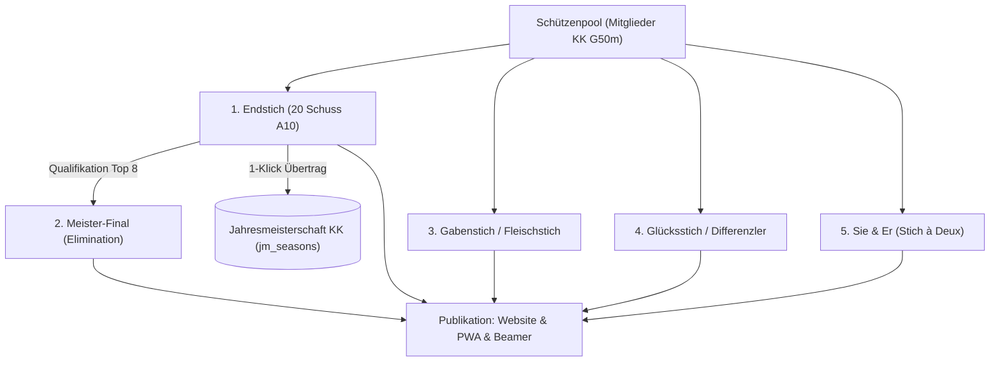
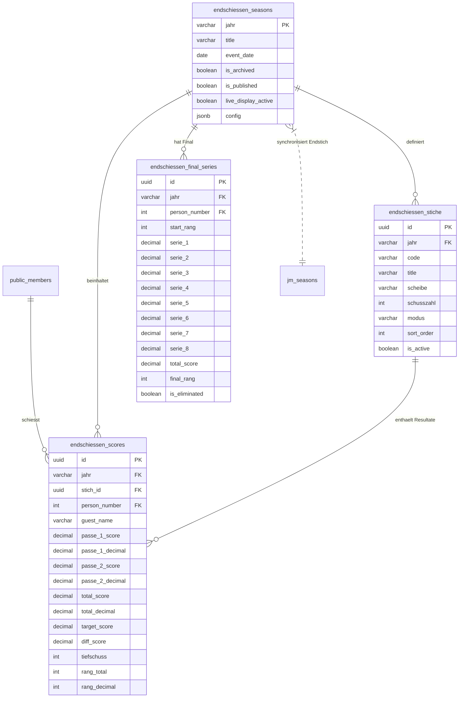

# Fachdokumentation: Modul Endschiessen (Saisonabschluss KK 50m)

> **Status:** SPEZIFIKATION & ARCHITEKTUR  
> **Stand:** Oktober 2026  
> **Zielarchitektur:** Supabase PostgreSQL (`endschiessen_seasons`, `endschiessen_stiche`, `endschiessen_scores`, `endschiessen_final_series`), Cloudflare R2, Vorstand-Cockpit (`vorstand/js/endschiessen/`), Website & PWA-Integration  
> **Berechtigungen (RBAC):** `endschiessen.view` (Einsehen) / `endschiessen.manage` (Erfassen & Mutieren)  

---

## 1. Ausgangslage & Zielsetzung

Das **Endschiessen** (auch *Schlussmatch* oder *Saisonabschluss-Schiessen*) bildet den festlichen, sportlichen und kameradschaftlichen Höhepunkt der Kleinkaliber-Freiluftsaison (50m) der Sportschützen Muhen.

Historisch wurden diese Wettkämpfe und Stiche oft auf separaten Standblättern und Excel-Dateien erfasst. Mit diesem Modul wird das Endschiessen vollständig in das Vereinsportal integriert:
1. **Single Source of Truth:** Alle Stiche, Passen, Zehntelwertungen, Differenzler- und Finaldaten liegen manipulations- und revisionssicher in Supabase PostgreSQL.
2. **Direkte Verknüpfung mit den Stammdaten:** Der Schützenpool speist sich automatisch aus den lizenzierten Kleinkaliber-Schützen (`public.members` + `public.member_licenses`).
3. **Nahtlose Jahresmeisterschafts-Integration:** Das Hauptprogramm (Endstich 20 Schuss) kann per 1-Klick direkt in die offizielle Kleinkaliber-Jahresmeisterschaft (`public.jm_seasons`) übertragen werden.
4. **Mehrere Stiche & Disziplinen (Reiter-System):** Endstich, Top-8-Final, Gabenstich (Fleischpreis), Differenzler/Glücksstich, Sie & Er sowie frei konfigurierbare Sonderstiche.
5. **Mehrjahres-Historie & Archiv:** Schneller Wechsel zwischen den Jahren (`2026`, `2025`, `2024`...) mit Archivierungs-Schreibschutz.
6. **Publikation & Live-Display:** Sofortige Veröffentlichung der Ranglisten auf der Vereinswebsite, in der Mitglieder-PWA sowie als dynamischer **Beamer-/Live-Screen-Modus** für die Schützenstube am Festabend.

---

## 2. Wettkampfprogramme & Stich-Formate (Analyse & Schweizer Standards)

Basierend auf den bestehenden Vereinsdokumenten (Beleg-Auswertung *Endstich & Final* der Sportschützen Muhen) sowie den gängigen Schweizer Kleinkaliber-Reglementen (SSV & Kantonalschützenverband) gliedert sich das Endschiessen in folgende Stiche:



### 2.1 Stich 1: Endstich (Hauptwettkampf 20 Schuss)
* **Programm:** 20 Schuss auf Scheibe A10 (eingeteilt in 2 Passen à 10 Schuss).
* **Doppelwertung (Ganzpunkte & Zehntel):**
  - **Passe 1:** 10 Schuss Ganzpunkte (max. 100) + Zehntelwertung (max. 109.0, z. B. `98` / `102.3`).
  - **Passe 2:** 10 Schuss Ganzpunkte (max. 100) + Zehntelwertung (max. 109.0, z. B. `100` / `104.8`).
  - **Total:** Ganzpunkte (max. 200, z. B. `198`) + Zehntel Total (max. 218.0, z. B. `207.1`).
* **Rangierungskriterium:**
  1. Höhere Summe Ganzpunkte (`total_score`).
  2. Bei Punktgleichheit: Höheres Zehnteltotal (`total_decimal`).
  3. Bei weiterer Gleichheit: Bessere zweite Passe (`passe_2_score` / `passe_2_decimal`).
* **Separate Wertungen:**
  - **Offizielle Endstich-Rangliste** (nach Ganzpunkten mit Zehntel-Tiebreaker).
  - **Zehntel-Rangliste** (reine Sortierung nach Zehntel-Punkte-Total, wie im Beleg-PDF dargestellt).
* **Jahresmeisterschafts-Relevanz:** Dieses Total (200 Punkte = 100 %) zählt für die KK-Jahresmeisterschaft.

---

### 2.2 Stich 2: Meister-Final (Ausscheidungs-Modus Top 8)
Der Final wird direkt aus den **besten 8 Schützen des Endstichs** bestritten (analog des offiziellen Schweizer Finalmodus):
* **Teilnehmer:** Rang 1 bis 8 des Endstichs. Bei Absage rückt der Nächstplatzierte nach.
* **Ablauf & Elimination (Serien 1 bis 8):**
  - Geschossen wird auf Kommando (z.B. Serien à 3 Schuss auf Scheibe A100 bzw. A10 Zehntelwertung, Einzelschusswertungen z. B. 280–295 Punkte).
  - **Serie 1 & 2:** Alle 8 Schützen schiessen die Eröffnungsserien.
  - **Ab Serie 2 (oder nach Plan):** Nach jeder weiteren Serie scheidet der Schütze mit dem tiefsten kumulierten Gesamttotal aus:
    - *Rang 8:* Ausscheiden nach Serie 1 bzw. 2 (z. B. Burkhalter Lukas mit 235 Punkten).
    - *Rang 7:* Ausscheiden nach Serie 2 (z. B. Fischer Marco mit 542 Punkten).
    - *Rang 6:* Ausscheiden nach Serie 3 (z. B. Morgenthaler Lars mit 829 Punkten).
    - *Rang 5:* Ausscheiden nach Serie 4 (z. B. Augsburger Beat mit 1109 Punkten).
    - *Rang 4:* Ausscheiden nach Serie 5 (z. B. Suty Martina mit 1396 Punkten).
    - *Rang 3 (Bronze):* Ausscheiden nach Serie 6 (z. B. Boss Ria mit 1682 Punkten).
    - *Serie 7 / Finale duel (Gold & Silber):* Die beiden verbleibenden Spitzenschützen schiessen um den Titel (z. B. Rossi Olivia 1992 Pkt. = **Rang 1** vs. Luginbühl Jürg 1979 Pkt. = **Rang 2**).
* **Live-Erfassung:** Der Schützenmeister tippt die Serien-Punkte Schuss für Schuss bzw. Serie für Serie ein; das System sortiert die Ränge live und blendet ausgeschiedene Schützen automatisch mit rotem Badge und Endrang aus.

---

### 2.3 Stich 3: Gabenstich / Fleischstich (Traditioneller Feststich)
* **Charakter:** Jeder Teilnehmer gewinnt einen Preis vom Gabentempel (traditionell Fleischpakete, Käselaibe oder Schokolade).
* **Modus:**
  - Z. B. 6 Einzelschüsse auf Scheibe A100 (oder A10 mit 100er-Wertung).
  - Gewertet wird entweder die **beste Punktesumme** oder der **beste Tiefschuss (Tiefpunkt/Teiler)**.
  - Nachdoppel möglich: Ein Schütze kann gegen Scheibengebühr zusätzliche Passen schiessen, wobei nur die beste Passe gewertet wird.

---

### 2.4 Stich 4: Glücksstich / Differenzler (Chancengleichheit für alle)
* **Charakter:** Hier gewinnt nicht zwingend der treffsicherste Schütze, sondern die beste Selbsteinschätzung oder das Schützenglück.
* **Modus (Differenzler):**
  - Der Schütze gibt **vor dem Schiessen** einen geheimen Zielwert ab (z. B. *«Ich schiesse 84 Punkte»*).
  - Geschossen werden 10 Schuss auf Scheibe A10 (ohne Probeschüsse und ohne Anzeige während des Schiessens).
  - **Wertung:** Rangierung nach kleinster absoluter Differenz: $\text{Differenz} = |\text{Ist-Punkte} - \text{Ziel-Punkte}|$.
  - Bei gleicher Differenz gewinnt der Schütze mit der höheren effektiven Punktzahl.

---

### 2.5 Stich 5: Sie & Er (Stich à Deux / Partnerstich)
* **Charakter:** Team-Wettkampf zwischen einem lizenzierten Aktivschützen und einer Begleitperson (Partner/in, Junior, Nicht-Lizenzierte/r oder ausgeloster Schützenkollege).
* **Modus:**
  - Beide Personen schiessen je z. B. 5 Schuss auf Scheibe A10.
  - Das System aggregiert beide Resultate zu einem gemeinsamen Team-Total.

---

### 2.6 Stich 6+: Flexibel konfigurierbare Zusatzstiche
* Der Schützenmeister kann über einen Button `+ Neuer Stich` jederzeit zusätzliche Wettbewerbe hinzufügen (z. B. *Veteranenstich*, *Juniorenstich*, *Liegend-/Aufgelegt-Spezialwertung*).
* Frei wählbare Parameter:
  - Scheibenart: `A10`, `A100`, `Felsen/ISSF`.
  - Schusszahl: $5, 6, 10, 20$.
  - Wertungsmodus: `Ganzpunkte`, `Zehntel`, `Tiefschuss (Teiler)`, `Differenzler`, `Team-Summe`.

---

## 3. Datenmodell in Supabase PostgreSQL (`supabase/migrations/77_endschiessen_module.sql`)

Das Datenmodell ist strikt relational und 3NF-normalisiert aufgebaut. Es knüpft nahtlos an die bestehenden Tabellen `public.members`, `public.member_licenses` und `public.jm_seasons` an.



### 3.1 DDL-Definitionen

```sql
-- ==============================================================================
-- 77_endschiessen_module.sql
-- Migration: Fachmodul ENDSCHIESSEN (Saisonabschluss KK 50m)
-- Projekt: Vereinsportal Sportschützen Muhen
-- ==============================================================================

-- 1. SAISONS / JAHRE
CREATE TABLE IF NOT EXISTS public.endschiessen_seasons (
    jahr VARCHAR(50) PRIMARY KEY,                       -- z. B. '2026', '2025'
    title VARCHAR(150) NOT NULL DEFAULT '',             -- z. B. 'Endschiessen 2026'
    event_date DATE,                                    -- Schiesstag
    is_archived BOOLEAN NOT NULL DEFAULT false,         -- Schreibschutz bei archivierten Jahren
    is_published BOOLEAN NOT NULL DEFAULT false,        -- Freigabe für Website & PWA
    live_display_active BOOLEAN NOT NULL DEFAULT false, -- Schützenstuben-Live-Modus
    config JSONB NOT NULL DEFAULT '{
        "jm_sync_col": "Endschiessen",
        "final_participants_count": 8,
        "default_active_tab": "endstich"
    }'::jsonb,
    created_at TIMESTAMPTZ NOT NULL DEFAULT now(),
    updated_at TIMESTAMPTZ NOT NULL DEFAULT now()
);

-- 2. STICHE (REITER-KONFIGURATION)
CREATE TABLE IF NOT EXISTS public.endschiessen_stiche (
    id UUID PRIMARY KEY DEFAULT gen_random_uuid(),
    jahr VARCHAR(50) NOT NULL REFERENCES public.endschiessen_seasons(jahr) ON DELETE CASCADE,
    code VARCHAR(50) NOT NULL,                          -- z. B. 'endstich', 'final', 'gaben', 'glueck', 'sie_er'
    title VARCHAR(150) NOT NULL,                        -- z. B. 'Endstich (20 Schuss)', 'Meister-Final'
    description TEXT,
    scheibe VARCHAR(50) NOT NULL DEFAULT 'A10',         -- 'A10', 'A100', 'Felsen'
    schusszahl INTEGER NOT NULL DEFAULT 20,
    modus VARCHAR(50) NOT NULL DEFAULT 'standard_20',   -- 'standard_20', 'final_elimination', 'tiefschuss', 'differenzler', 'team'
    sort_order INTEGER NOT NULL DEFAULT 1,
    is_active BOOLEAN NOT NULL DEFAULT true,
    created_at TIMESTAMPTZ NOT NULL DEFAULT now(),
    updated_at TIMESTAMPTZ NOT NULL DEFAULT now(),
    CONSTRAINT uq_endschiessen_stich UNIQUE (jahr, code)
);

-- 3. RESULTATE / STANDBLÄTTER
CREATE TABLE IF NOT EXISTS public.endschiessen_scores (
    id UUID PRIMARY KEY DEFAULT gen_random_uuid(),
    jahr VARCHAR(50) NOT NULL REFERENCES public.endschiessen_seasons(jahr) ON DELETE CASCADE,
    stich_id UUID NOT NULL REFERENCES public.endschiessen_stiche(id) ON DELETE CASCADE,
    person_number INTEGER REFERENCES public.members(person_number) ON DELETE SET NULL,
    guest_name VARCHAR(150),                            -- Falls Gastschütze (z. B. Sie & Er)
    
    -- Endstich 20 Schuss (2 Passen à 10 Schuss)
    passe_1_score NUMERIC(5,1) DEFAULT 0,               -- Ganzpunkte Passe 1 (max 100)
    passe_1_decimal NUMERIC(5,1) DEFAULT 0,             -- Zehntel Passe 1 (max 109.0)
    passe_2_score NUMERIC(5,1) DEFAULT 0,               -- Ganzpunkte Passe 2 (max 100)
    passe_2_decimal NUMERIC(5,1) DEFAULT 0,             -- Zehntel Passe 2 (max 109.0)
    
    -- Totals
    total_score NUMERIC(6,1) NOT NULL DEFAULT 0,        -- Summe Ganzpunkte (max 200)
    total_decimal NUMERIC(6,1) NOT NULL DEFAULT 0,      -- Summe Zehntel (max 218.0)
    
    -- Spezielle Modi (Glück, Gaben, Differenzler)
    target_score NUMERIC(5,1),                          -- Zielwert bei Differenzler
    diff_score NUMERIC(5,1),                            -- Berechnete Abweichung |total - target|
    tiefschuss INTEGER,                                 -- Bester Tiefschuss (1/1000mm oder Teiler)
    
    -- Ränge
    rang_total INTEGER,                                 -- Offizieller Rang nach Ganzpunkten
    rang_decimal INTEGER,                               -- Rang nach reiner Zehntelwertung
    
    remark TEXT,
    created_at TIMESTAMPTZ NOT NULL DEFAULT now(),
    updated_at TIMESTAMPTZ NOT NULL DEFAULT now(),
    CONSTRAINT uq_endschiessen_score_entry UNIQUE (jahr, stich_id, person_number, guest_name)
);

-- 4. MEISTER-FINAL (SERIEN 1–8 MIT ELIMINATION)
CREATE TABLE IF NOT EXISTS public.endschiessen_final_series (
    id UUID PRIMARY KEY DEFAULT gen_random_uuid(),
    jahr VARCHAR(50) NOT NULL REFERENCES public.endschiessen_seasons(jahr) ON DELETE CASCADE,
    person_number INTEGER NOT NULL REFERENCES public.members(person_number) ON DELETE CASCADE,
    start_rang INTEGER NOT NULL,                        -- Qualifikationsrang aus Endstich (1–8)
    
    -- Serien 1 bis 8 (Punkte z. B. auf Hunderter-Wertung oder Zehntel)
    serie_1 NUMERIC(6,1) DEFAULT 0,
    serie_2 NUMERIC(6,1) DEFAULT 0,
    serie_3 NUMERIC(6,1) DEFAULT 0,
    serie_4 NUMERIC(6,1) DEFAULT 0,
    serie_5 NUMERIC(6,1) DEFAULT 0,
    serie_6 NUMERIC(6,1) DEFAULT 0,
    serie_7 NUMERIC(6,1) DEFAULT 0,
    serie_8 NUMERIC(6,1) DEFAULT 0,
    
    total_score NUMERIC(7,1) NOT NULL DEFAULT 0,        -- Kumuliertes Total
    final_rang INTEGER,                                 -- Endrang (1 = Sieger, ..., 8)
    is_eliminated BOOLEAN NOT NULL DEFAULT false,       -- Kennzeichnung wenn ausgeschieden
    eliminated_in_serie INTEGER,                        -- In welcher Serie ausgeschieden
    
    created_at TIMESTAMPTZ NOT NULL DEFAULT now(),
    updated_at TIMESTAMPTZ NOT NULL DEFAULT now(),
    CONSTRAINT uq_endschiessen_final_shooter UNIQUE (jahr, person_number)
);
```

### 3.2 Indizes & Performance
```sql
CREATE INDEX IF NOT EXISTS idx_endschiessen_scores_lookup 
    ON public.endschiessen_scores(jahr, stich_id, rang_total);
CREATE INDEX IF NOT EXISTS idx_endschiessen_final_lookup 
    ON public.endschiessen_final_series(jahr, total_score DESC);
CREATE INDEX IF NOT EXISTS idx_endschiessen_published 
    ON public.endschiessen_seasons(jahr) WHERE is_published = true;
```

---

## 4. Berechtigungsmodell («View & Manage» Kontrakt nach Richtlinie 7)

Das Modul implementiert exakt das einheitliche symmetrische RBAC-2-Stufen-Modell:

| Recht | Schlüssel | Bedeutung & Freischaltung |
| :--- | :--- | :--- |
| **👁️ Einsehen** | `endschiessen.view` | Berechtigt zum Einsehen aller Ranglisten, Stiche und Zwischenstände im Cockpit (Read-Only). |
| **✏️ Verwalten** | `endschiessen.manage` | Berechtigt zur Erfassung von Schützen, Eintippen von Resultaten, Final-Steuerung, Synchronisation zur Jahresmeisterschaft und Veröffentlichung. |

### 4.1 RLS-Policies (Auszug)
```sql
ALTER TABLE public.endschiessen_seasons ENABLE ROW LEVEL SECURITY;
ALTER TABLE public.endschiessen_stiche ENABLE ROW LEVEL SECURITY;
ALTER TABLE public.endschiessen_scores ENABLE ROW LEVEL SECURITY;
ALTER TABLE public.endschiessen_final_series ENABLE ROW LEVEL SECURITY;

-- Leserecht: Öffentliche Website & PWA dürfen freigegebene Saisons lesen;
-- Vorstandsmitglieder mit 'endschiessen.view' sehen auch unveröffentlichte Entwürfe.
CREATE POLICY "endschiessen_seasons_select" ON public.endschiessen_seasons
    FOR SELECT TO authenticated, anon
    USING (is_published = true OR public.has_permission('endschiessen.view'));

CREATE POLICY "endschiessen_scores_select" ON public.endschiessen_scores
    FOR SELECT TO authenticated, anon
    USING (
        EXISTS (
            SELECT 1 FROM public.endschiessen_seasons s 
            WHERE s.jahr = endschiessen_scores.jahr AND (s.is_published = true OR public.has_permission('endschiessen.view'))
        )
    );

-- Schreibrechte: Strikt an 'endschiessen.manage' gebunden
CREATE POLICY "endschiessen_scores_write" ON public.endschiessen_scores
    FOR ALL TO authenticated
    USING (public.has_permission('endschiessen.manage'))
    WITH CHECK (public.has_permission('endschiessen.manage'));
```

---

## 5. Schützenpool: Lizenzierte Kleinkaliber-Schützen

Um Tippaufwand und Schreibfehler zu eliminieren, bezieht das Modul die Schützen direkt aus den Stammdaten der Mitgliederverwaltung.

### 5.1 SQL-Abfrage für den Kleinkaliber-Pool
```sql
SELECT 
    m.person_number,
    m.last_name,
    m.first_name,
    m.birth_date,
    EXTRACT(YEAR FROM m.birth_date)::int AS geburtsjahr,
    l.membership_category,
    l.license_category,
    l.license_type,
    CASE 
        WHEN EXTRACT(YEAR FROM m.birth_date) >= (EXTRACT(YEAR FROM CURRENT_DATE) - 20) THEN true 
        ELSE false 
    END AS is_junior
FROM public.members m
JOIN public.member_licenses l ON l.person_number = m.person_number
WHERE m.is_active = true 
  AND l.is_active = true
  AND (
      l.membership_category ILIKE '%50m%' 
      OR l.membership_category ILIKE '%Kleinkaliber%' 
      OR l.membership_category ILIKE '%Gewehr 50m%'
  )
ORDER BY m.last_name ASC, m.first_name ASC;
```

### 5.2 UI-Ablauf beim Hinzufügen von Schützen
1. Klick auf **«+ Schütze hinzufügen»** öffnet das Pool-Modal.
2. Der Schützenmeister sieht eine durchsuchbare Liste aller lizenzierten G50m-Schützen aus Muhen mit Status-Badges (`U21`, `Elite`, `Senior`, `Veteran`).
3. Checkbox-Auswahl oder 1-Klick-Button **«Alle lizenzierten Schützen laden»**.
4. Schnellerfassung für spontane Gäste (z. B. beim Sie-&-Er-Stich oder Plauschstich) ohne SSV-Nummer möglich.

---

## 6. Schnittstelle zur Kleinkaliber-Jahresmeisterschaft

Das Endschiessen ist ein offizieller Wertungswettkampf der KK-Jahresmeisterschaft. Bisher mussten die Punkte manuell in das Jahresmeisterschafts-Grid übertragen werden.

### 6.1 Automatische Synchronisation (`sync_endschiessen_to_jm`)
Über die PostgreSQL-Funktion `sync_endschiessen_to_jm(p_year VARCHAR)` werden die Endstich-Resultate atomar in die entsprechende Wettkampfspalte der Jahresmeisterschaft (`public.jm_seasons.raw_grid` und `public.jm_shooters`) übertragen.

```sql
CREATE OR REPLACE FUNCTION public.sync_endschiessen_to_jm(p_year VARCHAR)
RETURNS JSONB
LANGUAGE plpgsql
SECURITY DEFINER
AS $$
DECLARE
    v_updated_count INT := 0;
    v_score RECORD;
    v_raw_grid JSONB;
    v_col_idx INT := -1;
    v_row_idx INT;
    v_cell_score NUMERIC;
BEGIN
    -- 1. Berechtigung prüfen
    IF NOT public.has_permission('endschiessen.manage') AND NOT public.is_admin() THEN
        RAISE EXCEPTION 'Keine Berechtigung zur Synchronisation (endschiessen.manage erforderlich).';
    END IF;

    -- 2. Spalten-Index in jm_seasons ermitteln
    SELECT raw_grid INTO v_raw_grid FROM public.jm_seasons WHERE jahr = p_year;
    IF v_raw_grid IS NULL THEN
        SELECT raw_grid INTO v_raw_grid FROM public.jm_seasons WHERE jahr = 'current';
    END IF;

    -- Suchen der Spalte "Endschiessen" in Zeile 3 (Index 2)
    -- ... Iteration und Abgleich der Schützenzeilen via person_number ...
    
    RETURN jsonb_build_object(
        'success', true,
        'year', p_year,
        'updated_shooters', v_updated_count,
        'synced_at', now()
    );
END;
$$;
```

### 6.2 Frontend-Ablauf & Robuste Synchronisation (Human-in-the-Loop)
1. Im Header des Endstichs erscheint der Button **«In Jahresmeisterschaft übertragen»** (aktiviert, sobald Resultate vorliegen).
2. Ein Vorschau-Modal zeigt den Abgleich für die aktive Jahresmeisterschaft (`current`).
3. **Exakter Personenabgleich:** Der Abgleich im Grid erfolgt strikt nach Vorname UND Nachname (bzw. Lizenznummer), um Fehlzuordnungen bei Namensgleichheit (z. B. Rossi Andrea vs. Rossi Olivia) auszuschliessen.
4. **Automatische Nachberechnung & Schützen-Sync:** Nach Übertrag der Punkte (max. 200) und der Prozente in die dynamisch ermittelten Spalten (`Endschiessen` und `Endschiessen %`) wird die Gesamtwertung via `recalculateJMRawGrid` neu berechnet und die normalisierte Tabelle `public.jm_shooters` (`syncJMShootersToSupabase`) unmittelbar aktualisiert.
5. Nach Bestätigung wird die Übernahme ausgeführt und ein Erfolgs-Toast mit Revisionsvermerk ausgegeben.

### 6.3 Zentrales Speichern & TableKit
* **SaveButtonKit Dirty Tracker:** Mutationen (Schützen hinzufügen, Punktänderungen) schalten den Speichern-Button dynamisch auf `Speichern (N)` um. Beim Speichern werden neue Schützen (`insert`) und bestehende Resultate (`upsert`) atomar gesichert.
* **TableKit & Zehntel-Darstellung:** Volle Spaltensortierung via `TableKit.makeSortable`. Zehntelfelder besitzen eine garantierte Mindestbreite von 72px ohne Browser-Spin-Buttons, sodass Dezimalwerte (`104.8`) vollständig lesbar sind.
* **Website-Integration (Tab 4):** Auf der öffentlichen Vereinswebsite (`resultate.html` & `resultate.js`) werden bei freigegebener Saison (`is_published: true`) die Ranglisten für Endstich, Meister-Final und Sonderstiche dynamisch angezeigt (autorisiert via `79_grant_anon_endschiessen_and_rbac.sql`).

---

## 7. Frontend-Design & UI-Cockpit (`vorstand/js/endschiessen/`)

Das Frontend integriert sich nahtlos in das bestehende Design-System der Sportschützen Muhen:
* **Typografie:** `Outfit` (Überschriften & KPI-Zahlen) und `Plus Jakarta Sans` (Tabellen & UI).
* **Farbpalette:** Marineblau `#0f3a5d`, Akzentgrün `#10b981`, Warnorange `#f59e0b`.
* **TableKit-Standard:** Heller Sticky-Header (`z-index: 10`), Inline-Edits, Tastaturnavigation mit Pfeiltasten/Tab, dynamischer Speichern-Button (`SaveButtonKit`). Vollständige `TableKit`-Konformität mit `th[data-col-id]`, `th[data-sort-key]`, `tr[data-id]`, `td[data-cell]`, numerischer Sortierung (Punkte, Zehntel, Differenz), Spaltenbreiten-Resizing (`TableKit.makeResizable`) und reaktivem Treffer-Zähler (`#endschiessen-count-badge`).

### 7.1 Cockpit-Layout (Wireframe)

```
┌────────────────────────────────────────────────────────────────────────────────────────────────────────┐
│ 🎯 ENDSCHIESSEN 2026                 [ 2026 ▼ ]   [● Veröffentlicht]   [🔴 Live-Beamer]   [💾 Gespeichert]│
├────────────────────────────────────────────────────────────────────────────────────────────────────────┤
│ [ 🏅 Endstich (20 Schuss) ]  [ 🏆 Final Top 8 ]  [ 🥩 Gabenstich ]  [ 🎲 Differenzler ]  [ 👫 Sie & Er ]  [ + ] │
├────────────────────────────────────────────────────────────────────────────────────────────────────────┤
│ 💡 Schnell-Anleitung:                                                                                   │
│ 1. Trage Passe 1 & 2 (Punkte & Zehntel) ein.                                                          │
│ 2. Das System berechnet Total & Ränge automatisch in Echtzeit.                                          │
│ 3. Nach Abschluss: Klicke auf «Final Top 8 generieren» oder «In Jahresmeisterschaft übertragen».       │
├────────────────────────────────────────────────────────────────────────────────────────────────────────┤
│ 🔍 Suche: [..................]  | Filter: [ Alle Schützen ▼ ]        [ + Schütze hinzufügen ] [ 📄 PDF-Export ] │
├────────────────────────────────────────────────────────────────────────────────────────────────────────┤
│ Rang | Schütze           | Passe 1 (Pkt / Zehntel) | Passe 2 (Pkt / Zehntel) | Total Pkt | Zehntel | Rang Zehntel │
├────────────────────────────────────────────────────────────────────────────────────────────────────────┤
│   1  | Luginbühl Jürg    |   98    /   102.3       |   100   /   104.8       |   198     |  207.1  |     1        │
│   2  | Fischer Marco     |   99    /   102.9       |    99   /   101.3       |   198     |  204.2  |     9        │
│   3  | Rossi Olivia      |   98    /   102.3       |    99   /   104.7       |   197     |  207.0  |     2        │
│   4  | Suty Martina      |   98    /   102.3       |    99   /   102.4       |   197     |  204.7  |     5        │
│   5  | Morgenthaler Lars |  100    /   104.4       |    96   /   101.1       |   196     |  205.5  |     3        │
│  ... | ...               |   ..    /    ..         |    ..   /    ..         |   ...     |  ...    |    ..        │
└────────────────────────────────────────────────────────────────────────────────────────────────────────┘
```

### 7.2 Spezieller UI-Modus: Final Top 8 Cockpit
* Zeigt die 8 qualifizierten Schützen in vertikalen Karten oder dynamischen Tabellenzeilen.
* Nach Eingabe einer Serie (z. B. `Serie 3`) sortiert sich die Rangliste per Micro-Animation um.
* Der Letztplatzierte wird visuell mit einem roten Badge als *«Ausgeschieden (Rang X)»* markiert und fixiert.
* Für das Gold-/Silber-Duell in Serie 7 heben sich die beiden Finalisten mit goldenem und silbernem Glanz hervor.

---

## 8. Veröffentlichung: Website, Mitglieder-PWA & Live-Schützenstuben-Display

### 8.1 Öffentliche Vereins-Website (`sportschuetzen-muhen.ch`)
* Unter der Rubrik **Resultate** (`sportschuetzen-website/frontend/resultate.html`) ist der Reiter **«Endschiessen»** als eigenständiger Tab-Container (Geschwister-Element auf gleicher Hierarchieebene wie `#tab-mannschaft`) integriert.
* **Hash- & Query-Navigation:** Direkter Aufruf via `resultate.html#endschiessen` oder `?tab=endschiessen`.
* **Dynamische Saisonabfrage:** Standardmässig wird die neueste publizierte Saison (`is_published = true`) geladen, anstelle eines statisch codierten Kalenderjahres.
* Besucher können das Jahr wählen (`2026`, `2025`...) und interaktiv zwischen den Stichen wechseln.
* **Medaillen & Layout:** Ränge 1 bis 3 werden mit responsiven Podest-Badges (🥇, 🥈, 🥉) hervorgehoben; Tabellen folgen dem einheitlichen `.table-results`-Layout.
* **1-Klick PDF-Download:** Generierung der Rangliste als A4-Druckansicht mit Vereinswappen und Datum.

### 8.2 Mitglieder-PWA (Mobile App)
* Mitglieder können ihre Resultate direkt nach dem Schiessen auf dem Smartphone einsehen.
* Anzeige des eigenen Standblatts:
  - Wie viele Punkte habe ich in Passe 1 und 2 erzielt?
  - Welchen Rang belege ich im Endstich und in der Zehntelwertung?
  - Bin ich für den Final qualifiziert?

### 8.3 Schützenstuben-Live-Screen (Festabend- & Beamer-Modus)
* Über die URL `portal/live-endschiessen.html?jahr=2026` kann ein Vollbild-Dashboard für Beamer oder Grossbild-TVs im Schützenhaus aufgerufen werden.
* **Features:**
  - Dark-Mode mit kontrastreicher Typografie (auch aus 10 Metern Entfernung perfekt lesbar).
  - Automatisches Scrollen / Paging durch alle Stiche (alle 15 Sekunden wechselt die Ansicht zwischen Endstich, Gabenstich und Zwischenstand).
  - Bei laufendem Meister-Final: Live-Ticker mit Einzelschüssen und akustischem Signal bei Führungswechseln.

---

## 9. Schritt-für-Schritt-Anleitung für den Schützenmeister (Bedienungsanleitung)

> [!TIP]
> Diese Anleitung ist im Vorstandscockpit als einklappbarer Info-Banner direkt über der Ergebnistabelle integriert.

### Phase A: Vorbereitung (Vor dem Schiesstag)
1. **Jahr prüfen:** Wähle im Header das aktuelle Jahr aus (z. B. `2026`). Falls noch nicht vorhanden, klicke auf `+ Neues Jahr anlegen`.
2. **Stiche kontrollieren:** Prüfe unter den Reitern, ob alle gewünschten Stiche (Endstich, Gabenstich, Differenzler etc.) aktiv sind.
3. **Schützen vorladen:** Klicke auf `Schützenpool laden`, um alle aktiven G50m-Lizenzschützen mit einem Klick in den Wettkampf zu übernehmen.

### Phase B: Während des Schiessens (Standblatt-Erfassung)
1. **Endstich erfassen:**
   - Nimm das Standblatt des Schützen zur Hand.
   - Trage in der Zeile des Schützen die Werte für **Passe 1** (`Punkte` & `Zehntel`) sowie **Passe 2** (`Punkte` & `Zehntel`) ein.
   - Das System berechnet das Total und aktualisiert die Ränge in Sekundenschnelle.
2. **Speichern:** Klicke regelmässig auf den orangen Button `💾 Speichern`, um die Daten in Supabase zu sichern.
3. **Weitere Stiche erfassen:** Wechsle über die Reiter zu *Gabenstich*, *Differenzler* oder *Sie & Er* und trage die entsprechenden Punktzahlen oder Zielwerte ein.

### Phase C: Durchführung des Meister-Finals
1. **Finalteilnehmer ermitteln:** Sobald der Endstich abgeschlossen ist, wechsle in den Reiter **«🏆 Meister-Final»**.
2. **Klick auf «Top 8 übernehmen»:** Das System zieht automatisch die Ränge 1 bis 8 aus dem Endstich in das Final-Cockpit.
3. **Serien eintragen:**
   - Trage Serie für Serie die geschossenen Resultate der Finalisten ein.
   - Nach Serie 2 scheidet der 8. Rang aus; nach Serie 3 der 7. Rang usw.
   - Das System markiert ausscheidende Schützen automatisch rot.
   - Nach Serie 7 steht der Endschiessen-Meister fest!

### Phase D: Abschluss & Veröffentlichung
1. **Jahresmeisterschaft aktualisieren:** Klicke im Endstich auf **«In Jahresmeisterschaft übertragen»**. Bestätige das Vorschau-Modal – die Punkte fliessen direkt in die Gesamtwertung.
2. **Publizieren:** Aktiviere im Header den Schalter **«Öffentlich sichtbar»**. Die Ranglisten sind nun sofort auf der Website und in der Mitglieder-PWA für alle einsehbar.
3. **Ranglisten drucken:** Klicke auf `📄 Rangliste drucken`, um die offiziellen Ranglisten für das Absenden im Schützenhaus auszudrucken.

---

## 10. Implementierungs- & Rollout-Plan

| Phase | Modul / Schritt | Inhalt & Artefakte |
| :---: | :--- | :--- |
| **1** | **Datenbank & RLS** | `supabase/migrations/77_endschiessen_module.sql` einspielen (CT 117), Berechtigungen `endschiessen.view` & `endschiessen.manage` registrieren. |
| **2** | **Vorstand-Cockpit JS** | Ordner `vorstand/js/endschiessen/` anlegen (`endschiessen-core.js`, `endschiessen-ui.js`, `endschiessen-final.js`, `endschiessen-sync.js`). |
| **3** | **Navigation & Main** | Kachel & Menüpunkt in `vorstand/index.html` und `vorstand/js/main.js` mit Berechtigungsprüfung einbinden. |
| **4** | **Jahresmeisterschafts-Bridge** | Stored Procedure `sync_endschiessen_to_jm` testen und verifizieren. |
| **5** | **Website & PWA** | Veröffentlichungs-Komponente in `sportschuetzen-website/` und `app/` bereitstellen. |
| **6** | **Live-Beamer-Screen** | `portal/live-endschiessen.html` für Großanzeigen im Festzelt aufsetzen. |
| **7** | **E2E-Smoke-Test** | Probedurchlauf mit den 14 Schützen aus dem Original-Beleg (Luginbühl, Fischer, Rossi, etc.) durchführen. |
