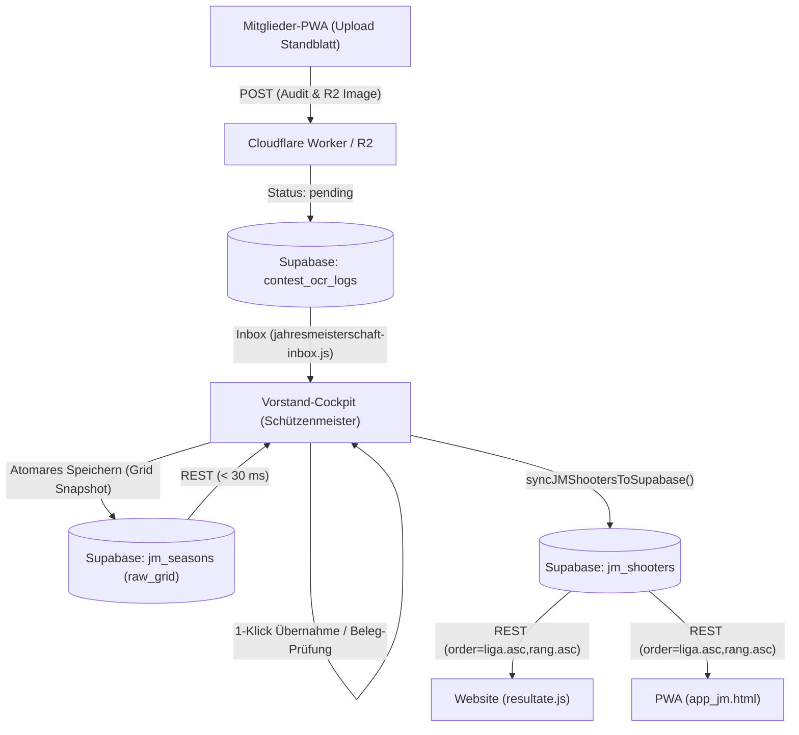
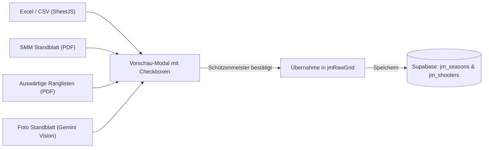

# Fachdokumentation: KK-Jahresmeisterschaft & Supabase-Migration

> **Status:** PRODUKTIV (Supabase Single Source of Truth)  
> **Stand:** 13. Oktober 2026  
> **Zielarchitektur:** Supabase PostgreSQL (`jm_seasons`, `jm_shooters`, `jm_competitions`), Cloudflare R2, Gemini Vision OCR  

---

## 1. Ausgangslage & Datenmodell

Die Kleinkaliber-Jahresmeisterschaft der Sportschützen Muhen basierte historisch auf einer komplexen 2D-Tabellenkalkulation in Google Sheets (`Jahresmeisterschaft_GAS_Original`). Mit dem Abschluss der Migrationsphasen ist **Supabase PostgreSQL** die verbindliche Single Source of Truth; sämtliche stillen GAS-Fallbacks und redundanten Dual-Writes wurden vollständig eliminiert.

### 1.1 Datenstrukturen in Supabase (`16_jahresmeisterschaft_module.sql`)

1. **`public.jm_seasons` (Snapshot- & Archivspeicher):**
   - Hält pro Saison (`jahr`, z. B. `'current'`, `'2025'`, `'2023'`) das vollständige zweidimensionale Tabellengrid im JSONB-Feld `raw_grid`.
   - Speichert im JSONB-Feld `junior_exclusions` die Liste der für die Junioren-Wertung deaktivierten Wettkämpfe.
   - Steuert über `is_archived` den Bearbeitungsschutz.
2. **`public.jm_shooters` (Normalisierte Auswertung):**
   - Strukturierte Einzeldaten jedes Schützen (`jahr`, `liga`, `rang`, `name`, `vorname`, `total_pct`, `streich_pct`, `details`).
   - Dient als performante Datenquelle für die öffentliche Website und die Mitglieder-PWA (Sortierung: `order=liga.asc,rang.asc`).
3. **`public.contest_ocr_logs` (Audit, Standblatt-Erfassung & Inbox):**
   - Revisionssicheres Logging aller Standblatt-Uploads (Schütze, Rohpunkte, Maximum, Bild-URL in Cloudflare R2, Status `pending`/`imported`/`rejected`).
   - Autorisierung via RLS (`50_contest_ocr_logs_jm_rbac.sql`): Berechtigung `jahresmeisterschaft.view` für Inbox-Einsicht und `jahresmeisterschaft.manage` für 1-Klick-Übernahme.
4. **`public.jm_competitions_catalog` (Schützenfeste-Katalog & Suchbegriffe):**
   - Hält alle bekannten Schützenfeste (z. B. Deisigraben, Bärenmoos, Winterthurer Liegendmatch), deren Standard-Maximalpunkte und semikolongetrennte Suchbegriffe (`suchbegriffe`).
   - Ermöglicht vollautomatisches Anlass- und Maximalpunkte-Matching bei PDF- und Screenshot-Uploads sowie Verwaltung direkt im Vorstandscockpit via globalem UI-Toolkit.
   - **UI-Standard & Ergonomie:** Vollständig harmonisiert auf die globalen UI-Toolkits (`UIModalKit`, `TableKit`, `UIExportKit`, `UIConfirmKit`, `UIButtonKit`). Das Katalog-Modal ist frei verschieb-, vergrösser- und maximierbar mit flexiblem Tabellen-Layout ohne feste Höhenbegrenzung. Die Tabelle unterstützt Spalten-Resizing (Aufziehen/Verkleinern per Drag), persistente Breiten im `localStorage`, Klick-Sortierung sowie einen 1-Klick-Excel-Export (`.xlsx`). Status-Filter-Pills (*Alle*, *Aktiv*, *Inaktiv*) und ein Suchfeld mit Schnell-Löschung ergänzen die Steuerung.

---

## 2. Systemarchitektur & Datenflüsse

### 2.1 Beantwortung der Kernfragen

* **Google Dual-Write entkoppelt?**
  Ja. In [`jahresmeisterschaft-manager.js`](file:///c:/Users/danhu/.gemini/antigravity/scratch/migration%20supabase/vorstand/js/jahresmeisterschaft/jahresmeisterschaft-manager.js) ist jeglicher Schreibzugriff auf Google Apps Script / Google Sheets deaktiviert. Das Cockpit schreibt direkt und atomar nach Supabase (`jm_seasons` und `jm_shooters`).
* **Lesen Website und PWA exklusiv aus Supabase?**
  Ja. Sowohl die Vereinswebsite ([`resultate.js`](file:///c:/Users/danhu/.gemini/antigravity/scratch/migration%20supabase/sportschuetzen-website/frontend/js/resultate.js)) als auch die Mitglieder-PWA ([`app_jm.html`](file:///c:/Users/danhu/.gemini/antigravity/scratch/migration%20supabase/app/app_jm.html)) fragen die Tabelle `public.jm_shooters` mit dynamischem SWR-Caching über die Supabase REST API ab.
* **Schreibt die PWA direkt in die Rangliste?**
  Nein. Die Erfassung in der PWA ([`upload.js`](file:///c:/Users/danhu/.gemini/antigravity/scratch/migration%20supabase/app/upload.js)) legt Standblätter in Cloudflare R2 ab und schreibt einen Eintrag mit Status `pending` inklusive vollständiger `ocr_analysis` (Schütze, Anlass, Punkte, Beweis-Text) in `public.contest_ocr_logs`. Gleichzeitig wird dem Schützen eine Eingangsbestätigung mit automatischer Kopie an den Verteiler `Info_Mail_Standblatt_Upload` (`public.system_mail_configs`) zugestellt. Die Freigabe und Einreihung obliegt dem Schützenmeister über die Standblatt-Inbox ([`jahresmeisterschaft-inbox.js`](file:///c:/Users/danhu/.gemini/antigravity/scratch/migration%20supabase/vorstand/js/jahresmeisterschaft/jahresmeisterschaft-inbox.js)) inklusive detailliertem 3-Spalten-Prüfbericht und On-Demand-Nachprüfung.
* **KI-Einsatz bei der Standblatt-Erkennung:**
  Über den zentralen Vorstand-API-Worker (`action=ocr_standblatt` / `action=ocr`) ist die Google Gemini Vision API integriert (`gemini-3-flash-preview` mit automatischem Multi-Modell Fallback auf `gemini-3.5-flash`, `gemini-flash-latest`, `gemini-3.8-flash`, `gemini-3.1-flash-lite`). Die Erkennungs-Pipeline führt einen 3-stufigen Abgleich durch: Schützenidentifikation (Vorname, Nachname, SSV-Lizenznummer & Barcode-Check, Jahrgang), automatischer Abgleich des Schiessanlasses mit den Spalten der aktuellen Jahresmeisterschaft sowie Erkennung von Stich, Punktzahl und Maximum.

---

## 3. Berechnungs- & Wertungsregeln im Cockpit

Die Auswertung der Jahresmeisterschaft erfolgt im Frontend über [`jahresmeisterschaft-ui.js`](file:///c:/Users/danhu/.gemini/antigravity/scratch/migration%20supabase/vorstand/js/jahresmeisterschaft/jahresmeisterschaft-ui.js) und [`jahresmeisterschaft-core.js`](file:///c:/Users/danhu/.gemini/antigravity/scratch/migration%20supabase/vorstand/js/jahresmeisterschaft/jahresmeisterschaft-core.js).

### 3.1 Tabellenaufbau, Maximum & Ligen-Integrität
* **Liga 1:** Zeilen 5–12 im 2D-Grid (immer exakt 8 Schützen).
* **Pufferzeilen:** Zeilen 13 und 14 dienen als Trennung und sind schreibgeschützt.
* **Liga 2:** Zeile 15 bis Tabellenende (variable Anzahl Schützen).
* **Dynamisches Maximum (%):** Das theoretische Maximum berücksichtigt das Streichresultat (-100 %) und berechnet sich dynamisch als `(activeCount > 1 ? (activeCount - 1) : activeCount) * 100 %` (bei 10 aktiven Wettkämpfen somit exakt 900 %).
* **Rangierung:** Schützen werden in Vorstand, PWA (`app_jm.html`) und Website (`resultate.js`) strikt nach `total` absteigend sortiert und die Ränge dynamisch neu vergeben (`1..8` in Liga 1, `1..n` in Liga 2). Spalte 0 (`colRang`) im 2D-Grid wird in `recalculateJMRawGrid()` synchron nachgeführt.

### 3.2 SMM Runden (1–7) & Top 4 Wertung
* Die 7 Einzelrunden der Schweizerischen Mannschaftsmeisterschaft (SMM) liegen in den Spalten 33–39 (bzw. 34–40 bei vorhandener Statusspalte).
* Das System ermittelt für jeden Schützen dynamisch die **4 höchsten Punkteresultate** und überträgt sie in die Meisterschaftsspalten 9–12 (`Mannschaft #1` bis `#4`).
* Im Cockpit werden die zählenden Top-4-Runden mit einem grünen Badge (`<i class="fas fa-check"></i>`) markiert; die verbleibenden 3 Runden werden automatisch durchgestrichen und als Streichrunden gekennzeichnet.

### 3.3 Streichresultat-Eindeutigkeit
* Ein Streichresultat wird nur abgezogen, wenn ein Schütze mindestens alle aktiven Meisterschaftswettkämpfe absolviert hat.
* Wurde das identische Tiefstresultat mehrfach erzielt, wird sowohl rechnerisch als auch visuell exakt **ein einziges Resultat** gestrichen (`streichMarked`).

### 3.4 Auswärtsschiessen (Rohwerte & Top 2, PDF- & KI-Erkennung & Löschfunktion)
* Sämtliche Auswärtsschiessen (Spalten ab Index 41 bzw. 42, z. B. Bärenmoos, Stumpenland) werden als reine Rohpunktzahlen (z. B. `95`) erfasst und dargestellt.
* Die beiden prozentual besten Auswärtsschiessen werden automatisch in die Meisterschaftsspalten 14 und 15 (`Auswärtiges 1` und `Auswärtiges 2`) übernommen.
* **Einheitlicher Titel-Standard mit Ortschaft & Kalenderjahr (`jmFormatCompetitionTitle`):** Spaltentitel für Auswärtsschiessen werden über `jmFormatCompetitionTitle(anlass, ort, jahr)` portalweit standardisiert im Format «Anlass (Ortschaft) Jahr» geführt (z. B. *Bärenmoos-Schiessen (Villmergen) 2026*, *Deisigrabenschiessen (Sulz) 2026*). Die Funktion verhindert redundante Dopplungen automatisch, falls der Ortsname (oder dessen Stamm) bereits im Anlassnamen enthalten ist (z. B. *Balsthaler Liegendmatch 2026*). Dieser Standard greift konsistent beim PDF-/OCR-Import, im Schützenfeste-Katalog, bei manueller Neuanlage sowie bei Freigaben aus der Standblatt-Inbox.
* **Löschen & Mutieren von Auswärtsschiessen:** Auswärtsschiessen können im Vorstandscockpit direkt in den Allgemeinen Einstellungen über das Mülleimer-Symbol `🗑️` in Zeile 3 oder über den Button «Auswärtiges Schiessen löschen» unwiderruflich gelöscht werden (`deleteAuswaertigesSchiessen`). Dabei wird die Spalte im Grid bereinigt, das Gesamttotal inklusive Top 2 automatisch nachrückend neu berechnet und atomar nach `jm_seasons` und `jm_shooters` synchronisiert.
* **Strikter Checkbox-Kontrakt für Meisterschafts-Export:** In `syncJMShootersToSupabase` werden ausschliesslich Wettkämpfe mit aktiver Checkbox in Zeile 0 (`grid[0][c]`) in das Array `details.schiessen` übernommen. Inaktive Wettkämpfe (z.B. Auswärtiges 2 oder Eidgenössisches) werden nicht exportiert und erscheinen nicht mehr in den Detail-Akkordeons von Website und Web-App. Sowohl im Tabellenkopf als auch in der Akkordeon-Summenzeile wird das dynamisch erreichbare Maximum (z. B. `max. 800%`) transparent ausgewiesen.
* **Intelligente PDF- & KI-Erkennung zweistelliger Jahrgänge & Mehrfach-Stiche:** Beim Einlesen von Auswärts-Ranglisten als digitales PDF (`jmProcessAuswaertigFromText`) oder per Vision-KI (`action=ocr_standblatt` / `action=ocr`) werden zweistellige Jahrgänge (`s.jg`) exakt maskiert, ohne echte Schiesspunkte abzuschneiden.
* **Mehrfach-Stich-Erkennung & Interaktive Stich-Auswahl (PDF & OCR/Screenshots):** Enthält eine Auswärts-Rangliste mehrere Stiche (z.B. *Kranz* Max. 80, *Vindonissa* Max. 100, *Wasserschloss* Max. 300 oder *Kranzstich*, *Vereinsstich/Deisigrabenstich*, *Auszahler*), erkennt der Parser die Spaltenstruktur sowohl in digitalen PDFs (über x-Koordinaten) als auch in eingefügten Screenshots/OCR-Texten (inkl. umgebrochener zweizeiliger Spaltentitel wie `Wasser-` / `schloss` sowie kopfloser Ausschnitte). Über alle Zeilen des Dokuments kalibriert das System automatisch die Wertebereiche (`obsMin..obsMax`) und das Programmmaximum (`80`, `100`, `120`, `150`, `200`, `300`, `600`/`654`) jeder Stichspalte. Dadurch werden auch Schützen, die nur einzelne Stiche geschossen haben (z. B. nur den 80er-Kranzstich), exakt der richtigen Stichspalte zugeordnet, ohne dass ein 300er-Auszahler am Zeilenende fälschlicherweise als 100er-Hauptstich übernommen wird. Im Import-Modal erscheint eine interaktive Auswahlleiste (`jmRenderStichPills` inkl. Schützenanzahl pro Stich), die standardmässig den zum Katalog-Maximum passenden Hauptstich vorselektiert und einen 1-Klick-Wechsel in Echtzeit ohne Re-Upload erlaubt.

### 3.5 Junioren-Wertung (U21)
* Berechnet dynamisch ein virtuelles Total für Nachwuchsschützen im Tab *Junioren-Wertung*.
* Die Schalterleiste im Tab liest alle Wettkämpfe dynamisch aus Zeile 3 (`grid[2]`) aus. Deaktivierte Wettkämpfe werden aus dem Gesamttotal des Juniors abgezogen. Einzig der Mannschaftsblock (Top 4) ist als feste Einheit verdrahtet.
* **Website & PWA:** Sowohl in der PWA ([`app_jm.html`](file:///c:/Users/danhu/.gemini/antigravity/scratch/migration%20supabase/app/app_jm.html)) als auch auf der Website ([`resultate.html`](file:///c:/Users/danhu/.gemini/antigravity/scratch/migration%20supabase/sportschuetzen-website/frontend/resultate.html)) werden Junioren (U21) in einer dedizierten Rangliste mit Einzelresultat-Akkordeon nach Total absteigend ausgewiesen.

### 3.6 Ansichtsmodi, Gesamt-Matrix & Excel-Export
* **Wertungs-Ansichtsmodus:** Toolbar-Umschalter für `Punkte`, `Prozent (%)` oder `Punkte & %` (Kombiansicht mit Badges).
* **Gesamt-Matrix:** Ein separater Tab visualisiert alle Spalten (Hauptwettkämpfe, Top 4 SMM, alle 7 SMM-Runden, Auswärtige und Gesamtwertung) mit optional einblendbaren Roh-Prozentspalten.
* **Zahlen-Priorität vor Zellenbegrenzung:** Die Matrix nutzt ein flexibles Layout (`width: max-content; min-width: 100%`) mit kompaktem Innenabstand (`padding: 2px 4px; font-weight: 700`), wodurch 3-stellige Resultate und Prozentwerte auch bei hoher Spaltendichte niemals abgeschnitten werden.
* **U21-Juniorenwertung integriert:** Die Gesamt-Matrix umfasst neben Liga 1 und Liga 2 eine vollwertige U21-Juniorentabelle mit Rangierung nach virtuellem Total und U21-Badges in den Hauptligen.
* **Horizontales Scrolling:** Ausgestattet mit Schnell-Scroll-Buttons (`[ ◀ Links ]`, `[ Rechts ▶ ]`), einer oberen synchronisierten Scrollleiste direkt über der Tabelle sowie automatischer Mausrad-Unterstützung (`wheel` auf `scrollLeft`).
* **Multi-Sheet Excel-Export (`.xlsx` via SheetJS):** 1-Klick-Export aller Daten in eine strukturierte Excel-Arbeitsmappe mit drei Reitern (*Liga 1*, *Liga 2*, *Junioren U21*) und automatisch berechneten Spaltenbreiten.

### 3.7 Export Auswärtsschiessen (PDF & Excel) & Bedienhilfen

* **Export (`jahresmeisterschaft-export.js`):** Über «Auswärtsschiessen exportieren» (Modul-Header und Karte «Wettkämpfe & Maximalpunkte») entsteht eine Liste nur der Auswärtsschiessen als A4-Querformat-PDF (jsPDF + `jspdf-autotable`) oder Excel (`UIExportKit.dataToExcel`). `jmBuildAuswaertigData()` liest ausschliesslich aus dem geladenen `jmRawGrid` (auch für Archivjahre, mit/ohne Statusspalte), nimmt nur Schützen mit mindestens einem Resultat auf und rangiert beide Ligen gemeinsam nach der Summe der prozentual besten Resultate (Anzahl gemäss aktiven Checkboxen «Auswärtiges 1/2», max. 200 %; gleiche Summe = gleicher Rang). Der Export erfordert nur `jahresmeisterschaft.view` und schreibt nichts in die Datenbank.
* **Markierung in der Rangliste:** Die zählenden Auswärtsresultate sind in den Ligatabellen gelb hinterlegt (gleiche Logik wie `updateTopAuswaertige`). «Auswärtiges 1/2» sind reine schreibgeschützte Berechnungsfelder mit klarem Tooltip; der irreführende Klick-Rechner-Einstieg wurde entfernt.
* **Neueinsteiger-Hilfen & Asynchrone Dialoge:** Aufklappbare Kurzanleitung, Archiv- bzw. «Nur Ansicht»-Banner und die einklappbare Karte «Wettkämpfe & Maximalpunkte» (Standard: eingeklappt). Alle Bestätigungs-, Hinweis- und Eingabedialoge nutzen zentral `UIConfirmKit` (`confirm`, `alert` sowie das neu eingeführte `prompt` inkl. Formularfeld-Unterstützung). Promises lösen sauber auf `hidden.bs.modal` auf, womit Race Conditions bei verketteten Dialogen vollständig eliminiert sind.
* **Performante Zelleingabe & Tastatur-Navigation (Paket B):** Bei der Punkteeingabe in Schützenzellen (`r > 4`) wird nicht mehr das gesamte Tabellen-DOM neu gerendert, sondern gezielt nur die betroffene Zeile via `updateShooterRowDOM(r)` nachgeführt (Totals, Top 4 SMM, Top 2 Auswärtige, Badges). Das Eingabefeld behält stets den Fokus. Mit `Enter` bzw. `ArrowDown` springt der Cursor direkt vertikal zum nächsten Schützen desselben Anlasses; mit `Tab` navigiert man horizontal durch die Zeile.

### 3.8 Schützengewinne bei Auswärtsschiessen: Gruppen-, Einzel- & Kombinations-Modell (Konto 1301)
* **Dedizierter 4. Haupt-Tab (`🏆 Schützengewinne (1301)`):** Die Schützengewinne sind als vollwertiger 4. Haupt-Tab (`#gruppengewinne-tab` mit Live-Badge für offene Schiessen und Typ-Filter-Pills `[Alle] [Offen] [👥 Gruppe] [🎯 Einzel] [👥+🎯 Kombiniert]`) direkt in die Jahresmeisterschaft integriert (`jmRenderGruppengewinneTabPane`), sodass kein verschachteltes Doppel-Modal mehr nötig ist. Alle zugeteilten Schützen, deren Resultate, Stichzuweisungen, Gewinnanteile und Verrechnungsstatus (`✅`/`⏳`) sind direkt als Badges in der Haupttabelle sichtbar.
* **Fachlogik, 3-Typen-Abrechnung & Live-FiBu-Abgleich:** Das Modul unterstützt drei Abrechnungstypen (`public.group_competitions.anlass_typ`):
  1. `gruppe`: Standard-Gruppenabrechnung mit Übernahme des Gruppendoppels durch den Verein (CHF 30.00 auf `4410`). Der Überschuss (`MAX(0, Gewinn - Doppel)`) wird zu gleichen Teilen auf die Gruppenschützen aufgeteilt.
  2. `einzel`: Reine Einzel- und Stichgewinne (z. B. Auszahler, Kategoriensieg, Gabe). Jeder Schütze erhält seinen persönlichen Gewinn gutgeschrieben; das Gruppendoppel entfällt.
  3. `kombiniert`: Kombinierte Auszahlung, wenn der Veranstalter Gruppenpreis und Auszahler in **einer einzigen Banküberweisung** an den Verein überweist. Der Gruppenüberschuss wird aufgeteilt und um die individuellen Einzelgewinne der Schützen ergänzt.
  Vier KPI-Karten weisen Brutto-Gewinn, Vereinsanteil Doppel-Deckung (`MIN(Gewinn, Doppel)`), Schützen-Ausschüttung (`1301`) sowie den Live-Abgleich mit `public.accounting_journal` (Konto `1301`) aus. In der FiBu verbuchte, aber im Modul noch fehlende Schiessen können per 1-Klick-Button direkt übernommen werden (`jmCreateCompFromFibuEntry`).
* **Erkennung beim PDF-Import & 3-stufiges Anlass-Dropdown:** Beim Einlesen von Auswärts-Ranglisten (`jahresmeisterschaft-import.js`) erkennt das System Gruppenstich-Ranglisten automatisch. Für die manuelle Erfassung bietet der Editor ein 3-stufiges Dropdown (*In JM vorhanden – offen*, *Bereits abgerechnet*, *Aus Festkatalog*) und lädt Schützen, Einzelpunkte sowie Gruppentotal vollautomatisch.
* **Ergonomisches Erfassungsmodal nach Portal-Standards:** Das Erfassungs- und Zuweisungs-Modal (`#jmGruppengewinnEditModal`) folgt den zentralen Vorstand-Portalstandards (`UIModalKit.makeMovableAndResizable`, `UIButtonKit.withLoading`): Die Dialogbreite ist auf bis zu 1360px (96vw) für Desktop optimiert, Betrags- und Punktefelder nutzen den Standard-CSS-Fix gegen störende Up/Down-Pfeile (`.jme-no-spin`), die 9 Tabellenspalten sind auf saubere 100% harmonisiert (ohne Text-Abschneiden bei Beträgen, Auszahlungsweg oder IBAN), und der Jahresmeisterschaft-Sync-Banner ordnet übernommene Schützen-Pillen luftig und übersichtlich mit `gap-2` unter einer eigenen Kopfzeile an.
* **1-Klick-Einzel- & Sammel-Übertrag in den Jahresbeitrag:** Neben dem Einzel-Übertrag direkt in der Tabellenzeile (`jmTransferSingleCompToJahresbeitrag`) überträgt der Sammel-Button «Alle offenen in Jahresbeitrag übertragen» (`jmTransferAllOpenToJahresbeitrag`) sämtliche offenen Schützengewinne der Saison in einem Durchgang nach `public.contributions_positions` (Konto `1301`). Bei kombinierten Schiessen werden transparente Teilzeilen erzeugt (`Gutschrift Gruppengewinn: ...` und `Gutschrift Einzelgewinn (<Stich>): ...`). In `jahresbeitrag-schnellerfassung.js` und `jahresbeitrag-calc.js` sind `1301`-Gutschriften beim Speichern in der Schnellerfassung strikt gegen Überschreiben geschützt und behalten sowohl `Gruppe` als auch `Einzel` bei. Nach dem Übertrag oder der Löschung bereits verrechneter Gewinne invalidiert `window.jbInvalidateCache({ refreshInvoices: true })` den In-Memory-Cache des Jahresbeitragsmoduls (`jahresbeitrag-core.js`), sodass beim unmittelbaren Modulwechsel auf *Jahresbeitrag* automatisch frisch aus Supabase (inkl. Entwurfsrechnungen) nachgeladen wird.
* **Nachträgliche Einzelgewinne auf bereits verrechneten Gruppen:** Wird eine bereits im Jahresbeitrag abgerechnete Gruppe auf *Gruppe & Einzel* umgestellt (`anlass_typ = 'kombiniert'`), bleiben die abgeschlossene Gruppenzuordnung (`anteil_gruppe`), Punkte und Schützen-Identität geschützt, während `Stich / Gabe` und `Einzel (CHF)` weiterhin editierbar sind. Bei Eingabe eines Einzelgewinns wechselt der offene Restbetrag (`getMemberOpenAmount`) gezielt auf *offen* (UI-Hinweis *Gruppe verrechnet · Einzel offen*), sodass beim erneuten Übertrag nur der fehlende Einzelgewinn ergänzt oder aktualisiert wird; bereits versendete oder bezahlte Jahresbeitrags-Rechnungen sind dabei strikt gegen Mutationen gesperrt. Werden zusätzlich Nicht-Gruppenschützen nur mit einem Einzelgewinn erfasst (`anteil_gruppe = 0`), ermittelt das Modul den Gruppen-Anteil je Schütze, das Gruppen-Punktetotal (`computeGroupPointsTotal`), die KPI-Aufteilung zwischen bereits verrechneten Gruppenanteilen und noch offenen Einzelgewinnen (`getMemberSplitAmounts`) sowie die Beleg-, Sammel-PDF-, Word- und E-Mail-Einzelberechnungen ausschliesslich über die effektiven Gruppenmitglieder (`getEffectiveGroupMembers`).
* **Gesamt-PDF, Word-Export (`.doc`) für Jahresbericht & Einzel-Beleg:** Über `jmExportGruppengewinneSummaryPdf` (A4-Querformat mit Gesamttabelle + Schützen-Saisonbilanz) und `jmExportGruppengewinneWord` (Word-Dokument mit druckfertigen Fliesstext-Bausteinen für den Jahresbericht des Schützenmeisters an der GV) lässt sich die gesamte Saison auf Knopfdruck exportieren; Einzelbelege für Gruppen-, Einzel- oder Kombinationsabrechnungen werden über `jmGenerateGruppengewinnPdf` erzeugt.

---

## 4. Resultate-Import & KI-Standblatt-Erkennung

Der Import ([`jahresmeisterschaft-import.js`](file:///c:/Users/danhu/.gemini/antigravity/scratch/migration%20supabase/vorstand/js/jahresmeisterschaft/jahresmeisterschaft-import.js)) läuft vollständig clientseitig im Browser ohne externe Skripte:

1. **Excel & CSV (SheetJS):**
   * Automatische Selektion des korrekten Tabellenblatts (z. B. `Eingabe` bei Kantonalstich, `Resultatblatt` bei Vereinswettschiessen).
   * Kopfzeilen- und Abrechnungsfilterung: Verhindert doppelte Schützenimporte durch strikten Abgleich auf Lizenz-, Namens- und Punktestruktur.
2. **Offizieller SSV SMM PDF-Standblatt-Import:**
   * Liest PDF-Standblätter via `pdf.js` ein.
   * Erkennt die Wettkampfrunde (1–7) autonom aus dem Dokumentkopf und extrahiert alle 8 Schützen inklusive Punkten.
3. **Auswärtige PDF-Ranglisten:**
   * Textblöcke werden über y-Koordinaten zu konsistenten Tabellenzeilen gruppiert (`extractLinesFromPdfPage`). Schützen aus Muhen werden via Lizenz- und Namensabgleich unter Maskierung von Jahrgängen exakt zugeordnet.
4. **Foto-Upload, Screenshot-Paste (Strg+V) & Gemini Vision OCR:**
   * Konvertiert Smartphone-Formate (inkl. Apple `.heic` via `heic2any`) clientseitig zu JPEG.
   * **Direktes Einfügen aus Zwischenablage (`Strg + V`):** Ranglisten-Ausschnitte (z. B. via Snipping-Tool / Win+Shift+S) können ohne Dateispeicherung direkt ins Modal eingefügt werden.
   * **Robuste OCR-Pipeline via Gemini Vision (`action=ocr_text`):** Das Bild wird an Google Gemini übergeben und der extrahierte Volltext zeilenweise an den intelligenten Textparser (`jmProcessAuswaertigFromText`) weitergeleitet.
   * **Zweiseitige Punkte-Erkennung:** Unterstützt sowohl Ranglisten mit Punkten nach dem Namen als auch Schweizer Ranglistenformate (z. B. WinFire-Gruppen- und Einzelranglisten), bei welchen die Punktzahl vor dem Schützennamen steht (z. B. `97 Fischer Marco 1986` oder `2. 99 Morgenthaler Lars 1988`).
   * **Nahtlose Synergie mit Gruppenwertungen:** Werden in einem Ausschnitt Gruppenranglisten erkannt (`jmDetectGroupCompetitionFromImportLines`), werden die dort identifizierten Schützen automatisch mit der Jahresmeisterschaft abgeglichen und in die Vorschautabelle übernommen.
   * **Liegendmatch & Zehntelwertung (Meyton / Sius):** Unterstützt 60-Schuss-Liegendmatches (Max. 600 bzw. 654 Punkte bei Zehntelwertung). Erkennt in mehrspaltigen Serien Ranglistentotale am Zeilenende (z. B. `621.0`, `618.5`) und unterscheidet zuverlässig zwischen Vereinsmitgliedern und Schützen ausserhalb der Jahresmeisterschaft.
5. **Intelligenter Schützenfeste-Katalogabgleich (`public.jm_competitions_catalog`):**
   * **Robuste Zonierungs- & Header-Erkennung:** Analysiert mit hoher Priorität den Dokumentkopf (Zeilen 1–15 bzw. erste 1'500 Zeichen) sowie den Dateinamen (+150/+100 Punkte), wo der eigentliche Wettkampfname steht.
   * **Schutz vor Fehlzuordnungen durch Gastvereine:** Ortsnamen (`ort`), die ausschliesslich im Body der Rangliste bei Gastsektionen (z.B. *Balsthal-Klus*, *Sulz*, *Gipf-Oberfrick* als Gastgruppen beim *Bärenmoos-Schiessen*) vorkommen, werden mit minimalem Gewicht gewertet und können niemals den tatsächlichen Anlass überstimmen.
   * **Bindestrich- & Normalisierungs-Toleranz:** Gleicht zusammengesetzte und getrennte Schreibweisen (z.B. *Bärenmoosschiessen* vs. *Bärenmoos-Schiessen*) ohne Zeichenverzerrung ab.
   * Erkennt den Anlass autonom, prüft die Synergie mit bestehenden Spalten der aktuellen Jahresmeisterschaft und weist automatisch die korrekten Maximalpunkte (z.B. 100 vs. 600/654) sowie die passende Zielspalte in der aktuellen Saison zu.
   * Der Name des Anlasses und die Maximalpunkte (inkl. Schnellauswahl-Pills 100/150/200/600) sind im Vorschau-Modal frei editierbar.
6. **Vorschau-Modal:**
   * Schützen können vor der Übernahme per Checkbox einzeln selektiert oder Punkte direkt überschrieben werden.

---

## 5. Saison-Lebenszyklus, Archivierung & Historie

### 5.1 Kontrollierter Saisonwechsel («Neues Jahr starten»)
Beim Starten eines neuen Jahres über das Aktionen-Menü wird ein automatisierter Ablauf angestossen:
1. **Ranglistenanalyse:** Ermittelt die finalen Ränge der abgelaufenen Saison.
2. **Liga-Transfer (Auf- und Abstieg):**
   - Die besten 2 Schützen aus Liga 2 steigen in Liga 1 auf.
   - Die letzten 2 Schützen aus Liga 1 steigen in Liga 2 ab.
   - Liga 1 behält exakt 8 Schützen; Liga 2 nimmt alle weiteren Schützen auf.
3. **Nullung:** Sämtliche Wettkampfresultate werden zurückgesetzt und das neue Grid atomar in `current` gespeichert.

### 5.2 Archiv-Snapshots & Status-Badges
* Vor dem Saisonwechsel wird die Saison über «Jahr archivieren» in `jm_seasons` persistiert (z. B. `2026`).
* Die Funktion `createArchivedGridWithStatus` fügt im Snapshot automatisch eine Statusspalte mit den Badges `▲ Aufstieg` und `▼ Abstieg` ein, wodurch historische Ranglisten konsistent dokumentiert bleiben.
* Archivierte Saisons sind im Vorstandscockpit schreibgeschützt und sperren Import-Aktionen.

---

## 6. Zentrales Speichern-UX-Muster (`SaveButtonKit`)
Das in der Jahresmeisterschaft bewährte dynamische Speichern-Muster wurde als portalweiter Standard in `SaveButtonKit` (`vorstand/js/main.js` und `vorstand/js/ui-table-kit.js`) überführt:
- **0 ungespeicherte Änderungen:** Deaktivierter, dezenter Button (`btn-outline-secondary`, `💾 Gespeichert`).
- **> 0 Änderungen:** Auffälliger Warn-Button (`btn-warning fw-bold`, `<i class="fas fa-save me-1"></i> Speichern (${count})`).
- **Speichervorgang:** Lade-Spinner während der asynchronen Supabase-Transaktion (`Speichern...`).
Dieses Muster wurde konsistent über alle Grid- und Listen-Module ausgerollt: Jahresmeisterschaft, Termine (Jahresprogramm), Resultate (Grenzland), Team-Manager, Eventplaner (Umfragen) und System-Mail-Verteiler.

---

## 7. Schnittstelle zur Mannschaftsmeisterschaft (`sync_jm_to_contest_mannschaft`)
Die in der Jahresmeisterschaft erfassten 7 Rohrunden der Schweizer Mannschaftsmeisterschaft (SMM, Spalten 33–39 bzw. `jm_shooters.details->'mannschaft'`) dienen als primäre Datenquelle für das Modul «Resultate Mannschaft & G & G» und die Vereins-Website. Über die PostgreSQL-Funktion `public.sync_jm_to_contest_mannschaft(p_year)` können die Punkte atomar nach `public.contest_results` synchronisiert werden, wodurch Doppelerfassungen vollständig eliminiert sind. Die Stored Procedure führt dabei automatisch einen Abgleich gegen `public.contest_setups` (Team Manager) durch: Nicht mehr im Team eingeteilte Schützen werden mit ihren Punkten in den Pool verschoben und Altbestände ohne Punkte bereinigt, sodass die Teams garantiert bei maximal 8 Schützen bleiben.

---

## 8. Schnittstelle zum Endschiessen (`syncEndschiessenToJM`)
Das Endschiessen (Saisonabschluss KK 50m) bildet einen zählenden Wertungswettkampf der Jahresmeisterschaft. Über die im Modul Endschiessen integrierte 1-Klick-Schnittstelle (`syncEndschiessenToJM` in `vorstand/js/endschiessen/endschiessen-core.js`) werden die Endstich-Ganzpunkte (max. 200 Punkte) der lizenzierten Schützen atomar in die Meisterschaftsspalte *Endschiessen* / *Schlussmatch* von `public.jm_seasons.raw_grid` übertragen. Ein vorgängiger Vorher-Nachher-Abgleich verhindert Fehleingaben und manuelle Doppelerfassungen.

---

## 9. Schützengewinne auswärtige Schiessen (Konto 1301: Gruppen- & Einzelgewinne), Ranglisten-Archiv & Jahresbeitrag
Bei auswärtigen Schiessen übernimmt der Verein reglementarisch das Gruppendoppel (standardmässig CHF 30.00). Darüber hinaus erzielte Gruppenüberschüsse sowie persönliche Einzel- und Stichgewinne (Auszahler, Gabenstich, Kategoriensiege) bilden die Schützengewinne und werden über das Bilanz-Transitkonto **1301** geführt (`jahresmeisterschaft-gruppengewinne.js`). Über die Schnittstelle zum Jahresbeitrag (`jmTransferCurrentCompToJahresbeitrag`) werden die Gewinnanteile der Schützen direkt als Abzugsposition im Jahresbeitrag verrechnet und revisionssicher auf der QR-Rechnung ausgewiesen (bei kombinierten Anlässen transparent aufgeteilt in `Gutschrift Gruppengewinn: ...` und `Gutschrift Einzelgewinn (<Stich>): ...`). Die PostgreSQL-Berechnung `calculate_member_contributions` bezieht die Gewinne aus `group_competition_members` dynamisch und idempotent ein, sodass Neuberechnungen oder Rücksetzungen im Jahresbeitrag die Gewinne stets konsistent erhalten.

Hochgeladene Ranglisten (PDFs oder via `Strg+V` eingefügte Snips) werden beim Import mit einem standardisierten Dateinamen (`jmBuildCleanRanglisteFilename`) einmalig im privaten Supabase-Storage-Bucket `jm-ranglisten` abgelegt (`public.jm_competition_files` & `group_competitions.ranglisten_files`), wobei PDF-Ranglisten stets zu 100 % vollständig mit allen Seiten erhalten bleiben und nur dann verlustarm komprimiert werden, wenn die Dateigrösse dadurch effektiv sinkt. Beim E-Mail-Versand des Jahresbeitrags (Einzel- und Sammelversand) wird für Schützen mit Konto-1301-Gutschriften automatisch die persönliche Einzelberechnung (`jmBuildShooterGruppengewinneMailSupplement`) samt kryptografisch signierten Direktlinks auf die Ranglisten (`createSignedUrl`, 180 Tage gültig, Ranglisten ausschliesslich als Link ohne Datei-Anhang) in die E-Mail eingebettet und zusätzlich das Übersichts-PDF `Zusammensetzung_Gruppengewinne_<Jahr>.pdf` (inkl. anklickbaren Ranglisten-Links) als E-Mail-Anhang beigefügt. Darüber hinaus ergänzt die serverseitige PDF-Engine (`generate-pdf`) bei Jahresbeitrags-Rechnungen mit Gruppengewinnen automatisch ein Beiblatt «Zusammensetzung Gruppengewinne» direkt im Rechnungs-PDF vor dem QR-Zahlteil.

