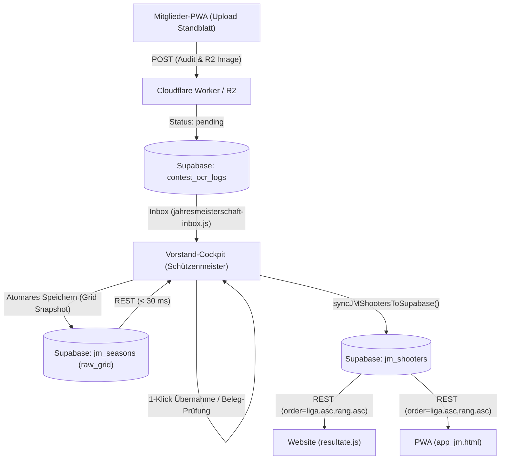
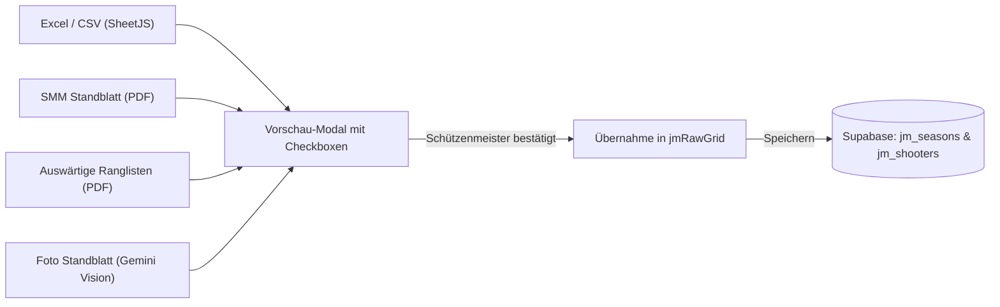

# Fachdokumentation: KK-Jahresmeisterschaft & Supabase-Migration

> **Status:** PRODUKTIV (Supabase Single Source of Truth)  
> **Stand:** 13. Oktober 2026  
> **Zielarchitektur:** Supabase PostgreSQL (`jm_seasons`, `jm_shooters`, `jm_competitions`), Cloudflare R2, Gemini Vision OCR  

---

## 1. Ausgangslage & Datenmodell

Die Kleinkaliber-Jahresmeisterschaft der Sportschützen Muhen basierte historisch auf einer komplexen 2D-Tabellenkalkulation in Google Sheets (`Jahresmeisterschaft_GAS_Original`). Mit dem Abschluss der Migrationsphasen ist **Supabase PostgreSQL** die verbindliche Single Source of Truth; sämtliche stillen GAS-Fallbacks und redundanten Dual-Writes wurden vollständig eliminiert.

### 1.1 Datenstrukturen in Supabase (`16_jahresmeisterschaft_module.sql`)

1. **`public.jm_seasons` (Snapshot- & Archivspeicher):**
   - Hält pro Saison (`jahr`, z. B. `'current'`, `'2025'`, `'2023'`) das vollständige zweidimensionale Tabellengrid im JSONB-Feld `raw_grid`.
   - Speichert im JSONB-Feld `junior_exclusions` die Liste der für die Junioren-Wertung deaktivierten Wettkämpfe.
   - Steuert über `is_archived` den Bearbeitungsschutz.
2. **`public.jm_shooters` (Normalisierte Auswertung):**
   - Strukturierte Einzeldaten jedes Schützen (`jahr`, `liga`, `rang`, `name`, `vorname`, `total_pct`, `streich_pct`, `details`).
   - Dient als performante Datenquelle für die öffentliche Website und die Mitglieder-PWA (Sortierung: `order=liga.asc,rang.asc`).
3. **`public.contest_ocr_logs` (Audit, Standblatt-Erfassung & Inbox):**
   - Revisionssicheres Logging aller Standblatt-Uploads (Schütze, Rohpunkte, Maximum, Bild-URL in Cloudflare R2, Status `pending`/`imported`/`rejected`).
   - Autorisierung via RLS (`50_contest_ocr_logs_jm_rbac.sql`): Berechtigung `jahresmeisterschaft.view` für Inbox-Einsicht und `jahresmeisterschaft.manage` für 1-Klick-Übernahme.

---

## 2. Systemarchitektur & Datenflüsse

### 2.1 Beantwortung der Kernfragen

* **Google Dual-Write entkoppelt?**
  Ja. In [`jahresmeisterschaft-manager.js`](file:///c:/Users/danhu/.gemini/antigravity/scratch/migration%20supabase/vorstand/js/jahresmeisterschaft/jahresmeisterschaft-manager.js) ist jeglicher Schreibzugriff auf Google Apps Script / Google Sheets deaktiviert. Das Cockpit schreibt direkt und atomar nach Supabase (`jm_seasons` und `jm_shooters`).
* **Lesen Website und PWA exklusiv aus Supabase?**
  Ja. Sowohl die Vereinswebsite ([`resultate.js`](file:///c:/Users/danhu/.gemini/antigravity/scratch/migration%20supabase/sportschuetzen-website/frontend/js/resultate.js)) als auch die Mitglieder-PWA ([`app_jm.html`](file:///c:/Users/danhu/.gemini/antigravity/scratch/migration%20supabase/app/app_jm.html)) fragen die Tabelle `public.jm_shooters` mit dynamischem SWR-Caching über die Supabase REST API ab.
* **Schreibt die PWA direkt in die Rangliste?**
  Nein. Die Erfassung in der PWA ([`upload.js`](file:///c:/Users/danhu/.gemini/antigravity/scratch/migration%20supabase/app/upload.js)) legt Standblätter in Cloudflare R2 ab und schreibt einen Eintrag mit Status `pending` in `public.contest_ocr_logs`. Die offizielle Freigabe und Einreihung in die Jahresmeisterschaft obliegt dem Schützenmeister über die neue Standblatt-Inbox ([`jahresmeisterschaft-inbox.js`](file:///c:/Users/danhu/.gemini/antigravity/scratch/migration%20supabase/vorstand/js/jahresmeisterschaft/jahresmeisterschaft-inbox.js)).
* **KI-Einsatz bei der Standblatt-Erkennung:**
  Über den zentralen Vorstand-API-Worker (`action=ocr_standblatt` / `action=ocr`) ist die Google Gemini Vision API integriert (`gemini-3-flash-preview` mit automatischem Multi-Modell Fallback auf `gemini-3.5-flash`, `gemini-flash-latest`, `gemini-3.8-flash`, `gemini-3.1-flash-lite`). Die Erkennungs-Pipeline führt einen 3-stufigen Abgleich durch: Schützenidentifikation (Vorname, Nachname, SSV-Lizenznummer & Barcode-Check, Jahrgang), automatischer Abgleich des Schiessanlasses mit den Spalten der aktuellen Jahresmeisterschaft sowie Erkennung von Stich, Punktzahl und Maximum.

---

## 3. Berechnungs- & Wertungsregeln im Cockpit

Die Auswertung der Jahresmeisterschaft erfolgt im Frontend über [`jahresmeisterschaft-ui.js`](file:///c:/Users/danhu/.gemini/antigravity/scratch/migration%20supabase/vorstand/js/jahresmeisterschaft/jahresmeisterschaft-ui.js) und [`jahresmeisterschaft-core.js`](file:///c:/Users/danhu/.gemini/antigravity/scratch/migration%20supabase/vorstand/js/jahresmeisterschaft/jahresmeisterschaft-core.js).

### 3.1 Tabellenaufbau, Maximum & Ligen-Integrität
* **Liga 1:** Zeilen 5–12 im 2D-Grid (immer exakt 8 Schützen).
* **Pufferzeilen:** Zeilen 13 und 14 dienen als Trennung und sind schreibgeschützt.
* **Liga 2:** Zeile 15 bis Tabellenende (variable Anzahl Schützen).
* **Dynamisches Maximum (%):** Das theoretische Maximum berücksichtigt das Streichresultat (-100 %) und berechnet sich dynamisch als `(activeCount > 1 ? (activeCount - 1) : activeCount) * 100 %` (bei 10 aktiven Wettkämpfen somit exakt 900 %).
* **Rangierung:** Schützen werden in Vorstand, PWA (`app_jm.html`) und Website (`resultate.js`) strikt nach `total` absteigend sortiert und die Ränge dynamisch neu vergeben (`1..8` in Liga 1, `1..n` in Liga 2). Spalte 0 (`colRang`) im 2D-Grid wird in `recalculateJMRawGrid()` synchron nachgeführt.

### 3.2 SMM Runden (1–7) & Top 4 Wertung
* Die 7 Einzelrunden der Schweizerischen Mannschaftsmeisterschaft (SMM) liegen in den Spalten 33–39 (bzw. 34–40 bei vorhandener Statusspalte).
* Das System ermittelt für jeden Schützen dynamisch die **4 höchsten Punkteresultate** und überträgt sie in die Meisterschaftsspalten 9–12 (`Mannschaft #1` bis `#4`).
* Im Cockpit werden die zählenden Top-4-Runden mit einem grünen Badge (`<i class="fas fa-check"></i>`) markiert; die verbleibenden 3 Runden werden automatisch durchgestrichen und als Streichrunden gekennzeichnet.

### 3.3 Streichresultat-Eindeutigkeit
* Ein Streichresultat wird nur abgezogen, wenn ein Schütze mindestens alle aktiven Meisterschaftswettkämpfe absolviert hat.
* Wurde das identische Tiefstresultat mehrfach erzielt, wird sowohl rechnerisch als auch visuell exakt **ein einziges Resultat** gestrichen (`streichMarked`).

### 3.4 Auswärtsschiessen (Rohwerte & Top 2)
* Sämtliche Auswärtsschiessen (Spalten ab Index 41 bzw. 42, z. B. Bärenmoos, Stumpenland) werden als reine Rohpunktzahlen (z. B. `95`) erfasst und dargestellt.
* Die beiden prozentual besten Auswärtsschiessen werden automatisch in die Meisterschaftsspalten 14 und 15 (`Auswärtiges 1` und `Auswärtiges 2`) übernommen.

### 3.5 Junioren-Wertung (U21)
* Berechnet dynamisch ein virtuelles Total für Nachwuchsschützen im Tab *Junioren-Wertung*.
* Die Schalterleiste im Tab liest alle Wettkämpfe dynamisch aus Zeile 3 (`grid[2]`) aus. Deaktivierte Wettkämpfe werden aus dem Gesamttotal des Juniors abgezogen. Einzig der Mannschaftsblock (Top 4) ist als feste Einheit verdrahtet.
* **Website & PWA:** Sowohl in der PWA ([`app_jm.html`](file:///c:/Users/danhu/.gemini/antigravity/scratch/migration%20supabase/app/app_jm.html)) als auch auf der Website ([`resultate.html`](file:///c:/Users/danhu/.gemini/antigravity/scratch/migration%20supabase/sportschuetzen-website/frontend/resultate.html)) werden Junioren (U21) in einer dedizierten Rangliste mit Einzelresultat-Akkordeon nach Total absteigend ausgewiesen.

### 3.6 Ansichtsmodi & Gesamt-Matrix
* **Wertungs-Ansichtsmodus:** Toolbar-Umschalter für `Punkte`, `Prozent (%)` oder `Punkte & %` (Kombiansicht mit Badges).
* **Gesamt-Matrix:** Ein separater Tab visualisiert alle Spalten (Hauptwettkämpfe, Top 4 SMM, alle 7 SMM-Runden, Auswärtige und Gesamtwertung) mit optional einblendbaren Roh-Prozentspalten.

---

## 4. Resultate-Import & KI-Standblatt-Erkennung

Der Import ([`jahresmeisterschaft-import.js`](file:///c:/Users/danhu/.gemini/antigravity/scratch/migration%20supabase/vorstand/js/jahresmeisterschaft/jahresmeisterschaft-import.js)) läuft vollständig clientseitig im Browser ohne externe Skripte:

1. **Excel & CSV (SheetJS):**
   * Automatische Selektion des korrekten Tabellenblatts (z. B. `Eingabe` bei Kantonalstich, `Resultatblatt` bei Vereinswettschiessen).
   * Kopfzeilen- und Abrechnungsfilterung: Verhindert doppelte Schützenimporte durch strikten Abgleich auf Lizenz-, Namens- und Punktestruktur.
2. **Offizieller SSV SMM PDF-Standblatt-Import:**
   * Liest PDF-Standblätter via `pdf.js` ein.
   * Erkennt die Wettkampfrunde (1–7) autonom aus dem Dokumentkopf und extrahiert alle 8 Schützen inklusive Punkten.
3. **Auswärtige PDF-Ranglisten:**
   * Textblöcke werden über y-Koordinaten zu konsistenten Tabellenzeilen gruppiert (`extractLinesFromPdfPage`). Schützen aus Muhen werden via Lizenz- und Namensabgleich unter Maskierung von Jahrgängen exakt zugeordnet.
4. **Foto-Upload & Gemini Vision OCR:**
   * Konvertiert Smartphone-Formate (inkl. Apple `.heic` via `heic2any`) clientseitig zu JPEG.
   * Gemini 2.5 Flash prognostiziert das Programmmaximum anhand typischer Schweizer Schiessprogramme ($60, 80, 100, 120, 150, 200, 300, 600$) und liefert eine nachvollziehbare Begründung.
5. **Vorschau-Modal:**
   * Schützen können vor der Übernahme per Checkbox einzeln selektiert oder korrigiert werden.

---

## 5. Saison-Lebenszyklus, Archivierung & Historie

### 5.1 Kontrollierter Saisonwechsel («Neues Jahr starten»)
Beim Starten eines neuen Jahres über das Aktionen-Menü wird ein automatisierter Ablauf angestossen:
1. **Ranglistenanalyse:** Ermittelt die finalen Ränge der abgelaufenen Saison.
2. **Liga-Transfer (Auf- und Abstieg):**
   - Die besten 2 Schützen aus Liga 2 steigen in Liga 1 auf.
   - Die letzten 2 Schützen aus Liga 1 steigen in Liga 2 ab.
   - Liga 1 behält exakt 8 Schützen; Liga 2 nimmt alle weiteren Schützen auf.
3. **Nullung:** Sämtliche Wettkampfresultate werden zurückgesetzt und das neue Grid atomar in `current` gespeichert.

### 5.2 Archiv-Snapshots & Status-Badges
* Vor dem Saisonwechsel wird die Saison über «Jahr archivieren» in `jm_seasons` persistiert (z. B. `2026`).
* Die Funktion `createArchivedGridWithStatus` fügt im Snapshot automatisch eine Statusspalte mit den Badges `▲ Aufstieg` und `▼ Abstieg` ein, wodurch historische Ranglisten konsistent dokumentiert bleiben.
* Archivierte Saisons sind im Vorstandscockpit schreibgeschützt und sperren Import-Aktionen.

---

## 6. Zentrales Speichern-UX-Muster (`SaveButtonKit`)
Das in der Jahresmeisterschaft bewährte dynamische Speichern-Muster wurde als portalweiter Standard in `SaveButtonKit` (`vorstand/js/main.js` und `vorstand/js/ui-table-kit.js`) überführt:
- **0 ungespeicherte Änderungen:** Deaktivierter, dezenter Button (`btn-outline-secondary`, `💾 Gespeichert`).
- **> 0 Änderungen:** Auffälliger Warn-Button (`btn-warning fw-bold`, `<i class="fas fa-save me-1"></i> Speichern (${count})`).
- **Speichervorgang:** Lade-Spinner während der asynchronen Supabase-Transaktion (`Speichern...`).
Dieses Muster wurde konsistent über alle Grid- und Listen-Module ausgerollt: Jahresmeisterschaft, Termine (Jahresprogramm), Resultate (Grenzland), Team-Manager, Eventplaner (Umfragen) und System-Mail-Verteiler.

---

## 7. Schnittstelle zur Mannschaftsmeisterschaft (`sync_jm_to_contest_mannschaft`)
Die in der Jahresmeisterschaft erfassten 7 Rohrunden der Schweizer Mannschaftsmeisterschaft (SMM, Spalten 33–39 bzw. `jm_shooters.details->'mannschaft'`) dienen als primäre Datenquelle für das Modul «Resultate Mannschaft & G & G» und die Vereins-Website. Über die PostgreSQL-Funktion `public.sync_jm_to_contest_mannschaft(p_year)` können die Punkte atomar nach `public.contest_results` synchronisiert werden, wodurch Doppelerfassungen vollständig eliminiert sind.

