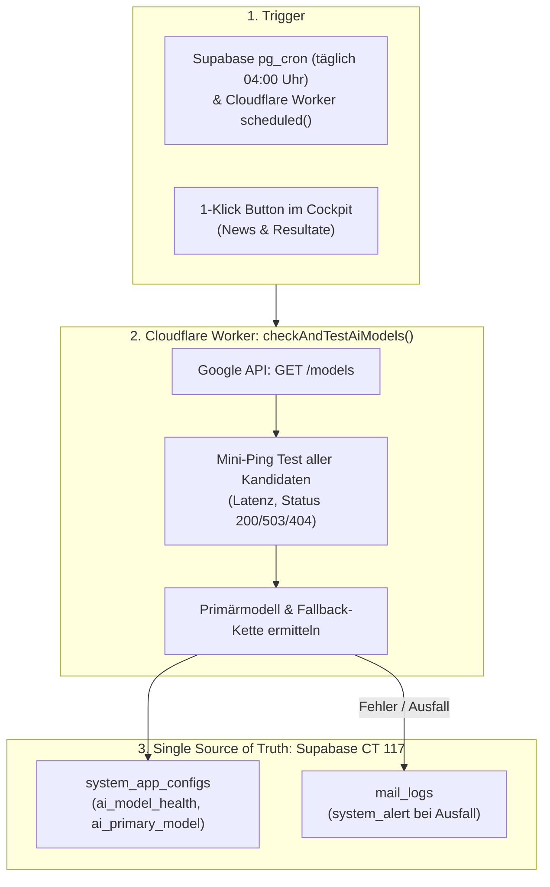

# Fachdokumentation: KI-Modell-Harmonisierung & Automatischer Healthcheck

> **Status:** PRODUKTIV IMPLEMENTIERT  
> **Stand:** 13. Oktober 2026  
> **Komponenten:** Cloudflare Worker (`v1-vorstand.js`), Supabase PostgreSQL (`system_app_configs`, `mail_logs`, `pg_cron`, `pg_net`), Vorstand-Cockpit (`ai-health.js`, `#modal-ai-health`)  

---

## 1. Ausgangslage & Problemstellung

Google deprecatiert ältere Gemini-Modelle (wie z.B. `gemini-2.5-flash` mit HTTP 404 *«no longer available»*) und verzeichnet bei einzelnen Flagship-Modellen (z.B. `gemini-3.8-flash` mit HTTP 503 *«UNAVAILABLE: high demand»*) temporäre Kapazitätsengpässe.

Da mehrere Fachmodule des Vereinsportals KI-Dienste nutzen:
1. **KI-News & Social Media** (Berichtserstellung, Bildinhaltsanalyse, Instagram/Facebook-Snippets)
2. **Protokoll-Archiv & Vision OCR** (Transkription alter Handschriften, Sütterlin & Fraktur)
3. **Standblatt-Erkennung** (PWA-Upload, SSV-Lizenz-, Barcode- und Anlass-Matching)
4. **Resultate OCR** (Auswärtige Schiessen, Rundenresultate)
5. **Umfragen / Generalversammlung** (Generierung von Einladungstexten)

durfte kein Modul mehr hardcodiert von einem einzelnen Sprachmodell abhängen. Bei einem Modell-Ausfall muss das System selbstheilend und transparent reagieren.

---

## 2. Architektur: 3-Säulen-Modell der KI-Harmonisierung



---

## 3. Die Komponenten im Detail

### 3.1 Einheitliche Ausführungskette (`executeGeminiWithFallback`)
Alle KI-Anfragen laufen zentral über `executeGeminiWithFallback` im Cloudflare Worker:
```javascript
const GEMINI_MODELS_FALLBACK_CHAIN = [
  'gemini-3-flash-preview',
  'gemini-3.5-flash',
  'gemini-flash-latest',
  'gemini-3.8-flash',
  'gemini-3.1-flash-lite'
];
```
- Fällt ein Modell mit `404`, `503` oder `429` aus, probiert der Worker automatisch das nächste Modell in der Kette.
- Für den Benutzer entsteht kein Verbindungsabbruch.

### 3.2 Automatischer Selbsttest & Modellentdeckung (`checkAndTestAiModels`)
Der Worker fragt Googles Model-Endpoint ab, entdeckt neue Modelle, filtert veraltete heraus und führt einen echten Ping-Test gegen jeden Kandidaten durch:
- **`healthy` (200 OK):** Modell ist online und einsatzbereit; Latenz wird gemessen.
- **`degraded` (503):** Modell ist temporär überlastet (z.B. *high demand*).
- **`deprecated` (404/410):** Modell wurde von Google eingestellt.
- **`quota_exceeded` (429):** API-Limit erreicht.

### 3.3 Persistierung in Supabase (`system_app_configs`)
Die Prüfergebnisse werden atomar in der Tabelle `public.system_app_configs` abgelegt:
- `key = 'ai_model_health'`: Vollständiger JSON-Prüfbericht inklusive Latenzen und Timestamp.
- `key = 'ai_primary_model'`: Das aktuell empfohlene Standardmodell (z.B. `gemini-3-flash-preview`).

### 3.4 Automatischer Cron-Job & Admin-Alarmierung
1. **Supabase `pg_cron` & `pg_net`:**
   In PostgreSQL ist Job #1 `ai-model-healthcheck` registriert, der täglich um 04:00 Uhr UTC via `net.http_get` den Worker aufruft:
   ```sql
   SELECT cron.schedule('ai-model-healthcheck', '0 4 * * *', $$
     SELECT net.http_get(url := 'https://v1-vorstand-api.dan-hunziker73.workers.dev/?action=check_ai_models');
   $$);
   ```
2. **Cloudflare Worker Cron Trigger:**
   Zusätzlich exportiert der Worker einen nativen `scheduled()`-Handler für maximale Redundanz.
3. **Alarmierung bei Ausfall:**
   Sollte das Standardmodell ausfallen oder kein gesundes Modell mehr verfügbar sein, wird automatisch ein Eintrag in `public.mail_logs` mit Status `system_alert` angelegt und der Administrator benachrichtigt.

### 3.5 Cockpit-UI & Platzierung (`ai-health.js` & `#modal-ai-health`)
Im Vorstand-Cockpit ist der Healthcheck optimal im Blickfeld platziert:
- **Sidebar-Footer (Systemweit):** Klickbarer Status-Indikator (`[ ⚡ KI-Status: Online (7) ]`) direkt über dem Benutzerprofil für sofortigen Zugriff aus jedem Modul.
- **Modul-Header:** Eleganter Status-Chip (`[ 🟢 KI betriebsbereit ]`) im Header von News KI und Resultate OCR.
- **Diagnose-Modal:** Detaillierte Übersicht aller Google Gemini Modelle mit Latenzen, Error-Gründen (503 High Demand, 429 Quota, 404 Deprecated) und 1-Klick On-Demand Test.

### 3.6 Autonome Modellwahl & «Zero Cognitive Load» (UX/UI)
- **Keine technischen Modellnamen für Endnutzer:** Vereinsfunktionäre und Redaktoren müssen keine komplexen API-Namen (`gemini-3.5-flash`, `gemini-3.1-flash-lite`) kennen oder vergleichen. Die Modellauswahl erfolgt standardmässig vollautonom (`value="auto"`), basierend auf dem aktuellen Healthcheck.
- **Admin-Override (Experten-Modus):** Autorisierte Administratoren können über ein dezentes Slider-Icon (`.role-protected` mit Rolle `admin`) ein Collapse-Menü öffnen, um bei Bedarf gezielt ein einzelnes Testmodell manuell zu erzwingen.

### 3.7 Live-Ausweich-Feedback (`#news-ai-status-box`)
- **Automatisches Failover ohne Unterbrechung:** Meldet ein Modell während der Text- oder Resultate-Erkennung temporäre Überlastung (`503 UNAVAILABLE / High Demand`), Quota-Limits (`429`) oder Timeouts, schaltet das Frontend selbstheilend auf das nächste gesunde Modell in der `recommended_chain` um.
- **Animierte Info-Box:** Anstelle einer kryptischen Fehlermeldung sieht der Benutzer im Lade-Overlay eine beruhigende Statusanzeige (*«Hohe Google-Auslastung: Weiche automatisch auf Ersatzmodell aus...»*). Der Benutzer muss keine Aktion ausführen.

### 3.8 Vision- & Multimodal-Filterung für Standblätter & OCR
- **Ausschluss von Audio- & Robotikmodellen:** Reine TTS- (Text-to-Speech), Audio-, Transkriptions- (`-transcribe`) und Robotik-Modelle (`gemini-robotics-er-2-preview`) werden in `initDynamicModels` und `ai-health.js` strikt herausgefiltert. Sie unterstützen keine Bildanalyse und dürfen nicht für OCR gewählt werden.
- **Standblatt- & Resultate-Payload (`action=ocr`):** Das Bild wird im JSON-Payload als `image` (Base64) übergeben. Der Worker liefert die erkannten Positionen im Array `ergebnisse` zurück und matcht sie auf die Schützenliste.

